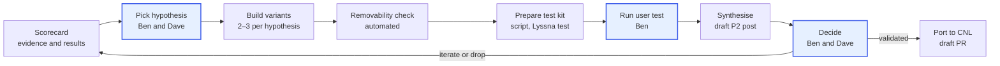

# Site Editor Ease: project plan

This is the source of truth for the project. Every agent reads it first and adds a line to the [Status log](#status-log) when it finishes a piece of work. People-facing writing lives on the [Site Editing Research P2](https://siteeditingresearchp2.wordpress.com/); this file is for running the work.

Owners: Ben (@scruffian) and Dave Smith (@getdave), who make decisions together.

## Goal

Make the WordPress.com Site Editor something new users can build their site with, instead of giving up on, so that fewer of them cancel or churn.

- **Success measure:** revenue, through lower cancellations, refunds and first-year churn. WordPress.com loses about 54% of annual and 91% of monthly subscribers in their first year ([AI 2026 Strategy](https://aip2.wordpress.com/2026/03/11/ai-2026-strategy/)), and usability or complexity is the top known refund reason ([refund analysis](https://dotcom.wordpress.com/2025/05/02/3d-refund-rate-analysis-v2-how-complexity-and-mismatched-expectations-cost-us-millions/)).
- **Leading signals before A/B tests:** task completion in user tests, See / Try / Know failures per session, and head-to-head preference.
- **Shipping route:** validated ideas go into [Create not Learn](https://github.com/Automattic/create-not-learn-editor) first. A/B testing on WordPress.com comes later, once there's more clarity.

## Who we're designing for, and what success looks like

The target user is someone using WordPress for the first time. The test of every idea: **a new user can complete basic editing tasks within 30 minutes without support** ([strategy page](https://siteeditingresearchp2.wordpress.com/site-editing-research-objectives-and-strategy/)).

The basic tasks, which every test kit should draw from:

1. Add or change text and images.
2. Add or remove sections on a page.
3. Add a new page.
4. Publish a blog post.
5. Set up the homepage.
6. Customise colours, fonts and site identity.

A user should manage these without needing to understand how WordPress works.

**Design principle: progressive disclosure.** At first, a section offers only high-level controls, such as cycling between predefined colour and layout options and making basic text edits. Lower-level block controls sit behind an intentional layer of friction, so experienced users can still reach them.

**Key tenets:**

- Move fast: lean into AI for implementation, prototype rapidly, avoid process overhead.
- Stay Core-adjacent: build plugins, use the WordPress Design System and packages, consume WordPress APIs, follow "the WordPress way".
- Build cohesive experiences that can be tested as a whole, not throwaway prototypes.
- Test every idea with real users.

**The hard problems**, at a high level: information overwhelm; system concepts exposed in the UI; local vs site-wide changes; in-canvas editing control (grid, drag and drop, toolbars); section-based page editing; the homepage; templates vs pages vs layouts; website building vs the blog-centric model; mobile editing; pages vs menus; navigation editing; editor vs front-end inconsistency. The [friction points post](https://siteeditingresearchp2.wordpress.com/2026/10/23/site-editor-friction-points/) breaks these down further.

## Constraints

Anything we ship on WordPress.com must leave sites working once the plugin is removed. So content stays valid core block markup, while the editing UI can change freely.

- **Allowed:** new sidebars, inspectors, toolbars, navigation, onboarding, flows, patterns, labels, presets that write core attributes.
- **Not allowed in shippable work:** anything core can't render the same way after removal. That means custom blocks, custom layout attributes, or free drag and drop positioning (core doesn't support it, so layouts would shift).
- **Learning-only prototypes** may break the rule, to find out *why* something works, but they're labelled as such and never go into CNL as they are.
- **Delivery mechanism is still to be decided:** either contribute to Core once validated, or ship a feature plugin on WordPress.com and test it with a percentage of real users. Either way, keep the data model in core; the UI is free to differ from Gutenberg.

## What we know

The problems are well evidenced. The fixes are not: so far, the clearest signal is that the Canva-like Gogh beats core in most head-to-head tests.

- **Size of the problem:** the Site Editor scores 2.62/5 on CES, lowest of 13 flows, and 36% of its feedback is "I'm lost". Site Editor chats take 17.8% of support chat time, and 58.7% of those are about templates. Only 6.5% of new users became active in June 2026. ([central resource](https://siteeditingresearchp2.wordpress.com/site-editing-central-resource/))
- **Mental model:** people separate site-wide decisions from page and element changes. All 8 who tried the editor failed their chosen change, through **See** (finding options, 7/8), **Try** (making changes, 8/8) and **Know** (understanding scope, 5/8). Templates are the biggest mismatch: people expect a starting point, not a shared layout. ([mental model study](https://researchp2.wordpress.com/2026/10/09/how-people-new-to-wordpress-build-their-sites-a-mental-model-of-site-editing/))
- **Prompting vs editing:** almost all sprint participants wanted both; none relied only on prompting. A bounded UI sometimes stopped them from doing what they wanted. ([sprint recap](https://siteeditingresearchp2.wordpress.com/2026/10/13/site-editing-design-sprint-recap/))
- **Friction points:** 14 so far, from mobile editing to hard-to-find block controls ([friction points](https://siteeditingresearchp2.wordpress.com/2026/10/23/site-editor-friction-points/)). The [Scorecard](#scorecard) tracks them.

| Test | Compared | Preferred |
| --- | --- | --- |
| [Jaime, 16 Oct](https://siteeditingresearchp2.wordpress.com/2026/10/16/gogh-vs-albers-vs-core/) | Gogh, Albers, Core | Gogh |
| [Damita, 16 Oct](https://siteeditingresearchp2.wordpress.com/2026/10/16/albers-vs-gogh/) | Albers, Gogh | Albers |
| [James, 16 Oct](https://siteeditingresearchp2.wordpress.com/2026/10/16/gogh-vs-albers-vs-cnl/) | Gogh, Albers, CnL | Gogh |
| [Mary, 10 Oct](https://siteeditingresearchp2.wordpress.com/2026/10/10/core-editor-vs-gogh/) | Core, Gogh | Gogh |
| [Kelsey, 10 Oct](https://siteeditingresearchp2.wordpress.com/2026/10/10/canva-vs-ai-site-editor-kelsey/) | Canva, AI Site Editor | AI Site Editor |

**The tension:** Gogh's free drag and drop breaks the removability rule. The key open question is which part of its appeal can survive inside core's layout model. (Gogh is James Marsland's page builder, not an experiment in this repo.)

## The learning loop

The slow part is learning, not building, so the setup is built around a weekly test, not around agent autonomy.

Highlighted steps belong to Ben and Dave; the rest are agent work. A variant that fails the removability check can still be tested, but only as learning-only work; it never goes into CNL as it is.

## Who does what

Agents do the preparation and the write-ups. Ben and Dave keep three things: choosing what to test, running moderated sessions, and deciding what goes into CNL.

| Role | Does | Output | Can do without asking |
| --- | --- | --- | --- |
| Coordinator | Reads this plan and the Scorecard, proposes the week's hypothesis, starts the other agents, updates the Status log | Weekly proposal and summary | Create issues, update this file |
| Researcher | Reads P2s, support and test posts; keeps the evidence for each friction point current | Scorecard rows with sources | Edit the Scorecard |
| Prototyper | Builds 2–3 variants per hypothesis in this repo, named by the artist convention (see README) | Experiment folders, Playground links | Open PRs and merge into this repo |
| Checker | Runs the removability check on every variant; reviews code it didn't write | Pass/fail report per variant | Block a variant from testing |
| Test prep | Writes task scripts, Playground blueprints and unmoderated Lyssna tests, drawn from the six basic tasks | Test kit per session | Draft tests; launching or paying for Lyssna needs Ben |
| Synthesiser | Turns Lyssna transcripts and Ben's notes into a See / Try / Know write-up | Draft P2 post, Scorecard update | Draft posts; publishing needs Ben |
| Integrator | Ports approved ideas into CNL | Draft PR on CNL | Open draft PRs only |
| **Ben and Dave** | Pick the hypothesis, run moderated sessions, interpret results, approve CNL changes | Decisions | Everything |

**Always ask Ben first:** anything in Gutenberg or CNL trunk, publishing on a P2, contacting participants, spending money, or changing this plan's Goal or Constraints.

## Weekly rhythm

One learning cycle a week, matching the commitment to at least one user test weekly. Ben's input is a pick on Monday, the session itself, and a decision afterwards.

1. **Monday (scheduled):** the Coordinator proposes the week's hypothesis from the Scorecard, with 2–3 variants and a one-line reason. Ben or Dave picks or edits it.
2. **Monday–Wednesday:** Prototypers build the variants; the Checker runs the removability check and reviews them.
3. **Thursday (scheduled):** test prep produces the moderated script, Playground links, and an unmoderated Lyssna version to run in parallel.
4. **Test day:** Ben runs the moderated session(s); unmoderated tests collect more participants.
5. **After the test:** the Synthesiser drafts the P2 post from the transcripts, updates the Scorecard, and lists the decisions needed.
6. **Decision:** Ben and Dave decide to port, iterate or drop; the Integrator opens a CNL draft PR for anything approved. Happiness reviews ideas once they've been through user testing, before they go to real users on WordPress.com.

Every run starts by reading this file and ends by adding a line to the Status log, so no run depends on an earlier chat.

## Removability check

Every variant is tested automatically before it reaches a user: if removing the plugin changes the content, the variant is marked learning-only.

1. Start a Playground with the theme under test and the experiment active.
2. Run a scripted set of edits through the experiment's UI (layout change, colours, text styles, image swap, navigation change), then save.
3. Record the saved post and template markup and a screenshot of each front-end page.
4. Deactivate the plugin.
5. Check that every block validates in core (no invalid-block warnings), that the markup has no unknown blocks or attributes, and that front-end screenshots match within a small tolerance.
6. Report pass or fail per page, with the diff.

The script lives in this repo so every experiment uses the same check. It only applies to experiments that are WordPress plugins; plain HTML prototypes are learning-only by nature. Building it is the first agent task (see Status log).

## Sharing findings

Findings go on the [Site Editing Research P2](https://siteeditingresearchp2.wordpress.com/). Agents write drafts there through the WordPress.com connector, and Ben publishes them.

- **Per-session post:** follows the existing format: a title naming what was compared ("Gogh vs Albers vs Core"), a first line `Winner: <name>`, a short narrative, then See / Try / Know observations with timestamps from the transcript, tagged `#user-testing`.
- **Weekly roll-up:** what was tested, what it means for the Scorecard, and the decision taken, linking to each session post.
- **Central resource:** new test posts are added to the User Experience Testing list on the [Site Editing Central Resource](https://siteeditingresearchp2.wordpress.com/site-editing-central-resource/).
- **Lyssna transcripts:** there's no Lyssna connector, so agents fetch transcripts through Ben's signed-in browser, or Ben exports them. Participant names are first names only, as now.

## Scorecard

One row per friction point from the [friction points post](https://siteeditingresearchp2.wordpress.com/2026/10/23/site-editor-friction-points/). Agents keep the evidence and results current; Ben and Dave set the status. The experiment mapping comes from each experiment's README and still needs Ben's check.

Status values: No experiment · Prototyped · In testing · Promising · Validated · Dropped.

| Friction point | See / Try / Know | Experiments | Results so far | Status |
| --- | --- | --- | --- | --- |
| Mobile editing | Try | Cassatt | — | Prototyped |
| Page vs template editing unclear | Know | Templates inside templates (Gutenberg), CNL, Judd | — | Prototyped |
| Unsure what editing a template will do | Know | CNL, Judd, Hepworth | Joanne struggled with templates vs pages in CNL | Prototyped |
| Unclear how to edit the homepage | See | — | Natacha was confused that the home page wasn't in Pages | No experiment |
| Homepage templates unclear | Know | Templates inside templates (Gutenberg) | — | Prototyped |
| Pages vs navigation confusion | See | O'Keeffe, Quinn | — | Prototyped |
| Navigation hard to edit | Try | Quinn, O'Keeffe | — | Prototyped |
| Templates have different headers and footers | Know | Templates inside templates (Gutenberg) | — | Prototyped |
| Hard to reset edits | Try | Judd (drafts, compare, history) | — | Prototyped |
| Layout changes are hard to make | Try | Albers, Bourgeois, Degas, Ito, Pollock, Gogh (external) | Gogh preferred in 3 of 4 head-to-heads, but breaks removability | In testing |
| Editor and preview look different | Know | — | — | No experiment |
| Blocks seem locked (Edit pattern) | Try | Nevelson, Degas | P8 backed away from Edit pattern | Prototyped |
| Hard to insert blocks | See | Albers, Degas (Add section) | P2 missed the inserter | Prototyped |
| Hard to find block controls | See | Escher, Frankenthaler, Hepworth, Morris, Nevelson | James couldn't find font selection in Gogh's toolbar | In testing |

## Open questions

- [ ] Which part of Gogh's appeal survives inside core's layout model: direct manipulation, fewer choices, or freedom to move things?
- [ ] Should validated ideas go upstream into Gutenberg at all, or stay a WordPress.com layer?
- [ ] Is CNL still the single place validated ideas land, or should some ship as separate small plugins?
- [ ] How do we tie leading signals from tests to churn before A/B testing is ready?
- [ ] Who is the Decider when Ben and Dave disagree, or when a change needs leadership backing?
- [ ] How do we reduce Lyssna no-shows (1 of 5 attended during the sprint)?
- [ ] How exactly do we bring Happiness in once an idea has been through user testing?

## Where things live

| What | Where |
| --- | --- |
| This plan | `PLAN.md` in [Automattic/site-editing-experiments](https://github.com/Automattic/site-editing-experiments) |
| Create not Learn (canonical) | [Automattic/create-not-learn-editor](https://github.com/Automattic/create-not-learn-editor). Older links point to getdave/create-not-learn-editor; don't use it. |
| Experiments | This repo, one folder per experiment, named after artists alphabetically; next is R ([live](https://automattic.github.io/site-editing-experiments/)) |
| Templates inside templates | Ben's Gutenberg PRs plus a Twenty Twenty-Five companion PR in wordpress-develop |
| Strategy and objectives | [Site Editing Research Objectives and Strategy](https://siteeditingresearchp2.wordpress.com/site-editing-research-objectives-and-strategy/) |
| Public overview | [Our approach to making the Site Editor easier](https://siteeditingresearchp2.wordpress.com/2026/11/12/our-approach-to-making-the-site-editor-easier/) |
| Evidence index | [Site Editing Central Resource](https://siteeditingresearchp2.wordpress.com/site-editing-central-resource/) |
| Test write-ups and findings | [Site Editing Research P2](https://siteeditingresearchp2.wordpress.com/), tag `#user-testing` |
| Session transcripts | Lyssna (no connector yet: Ben's signed-in browser, or exports from Ben) |

## Status log

Newest first. One line per piece of work: what changed and what's next.

| Date | Entry |
| --- | --- |
| 2026-11-12 | Plan moved here from a Claude doc. Experiment mapping in the Scorecard updated from the experiments' READMEs. Next: build the removability check. |
| 2026-11-12 | Added the strategy page's target user, 30-minute goal, basic tasks, tenets and hard problems. Confirmed Automattic/create-not-learn-editor is canonical. Overview post published. |
| 2026-11-12 | Plan drafted from the research P2s. Proposed first tasks: build the removability check, confirm the Scorecard mapping with Ben, then set up the Monday and Thursday scheduled tasks. |
