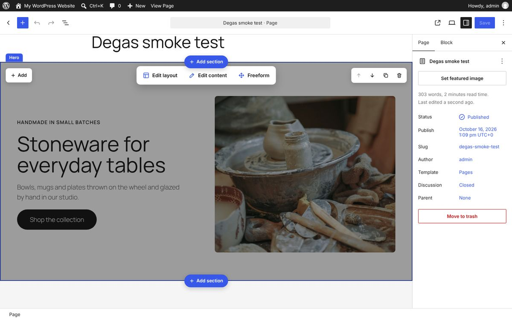
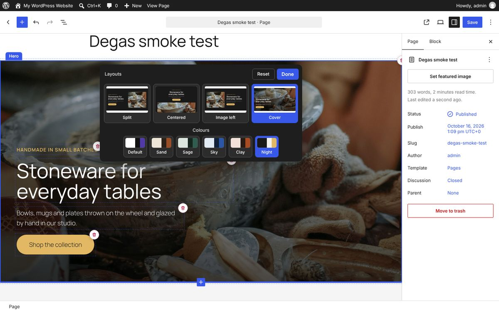
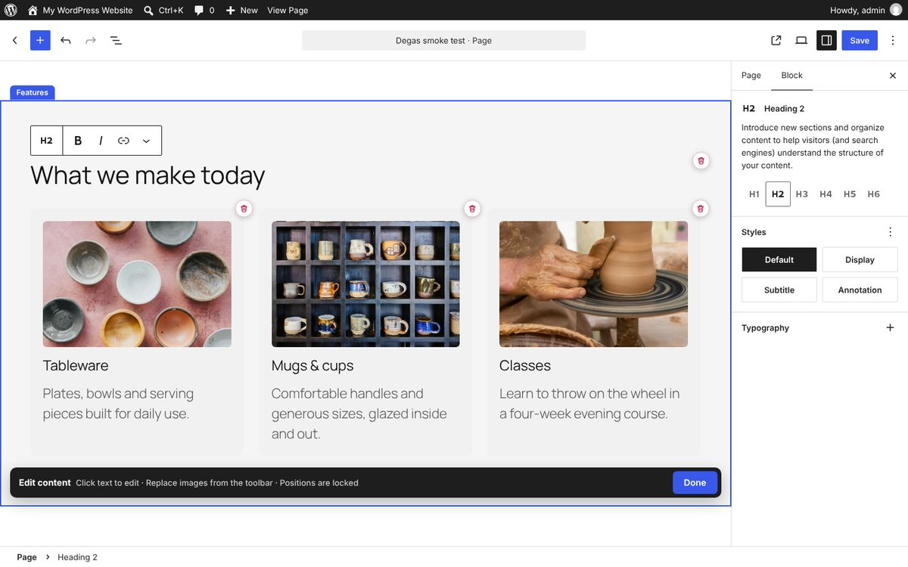
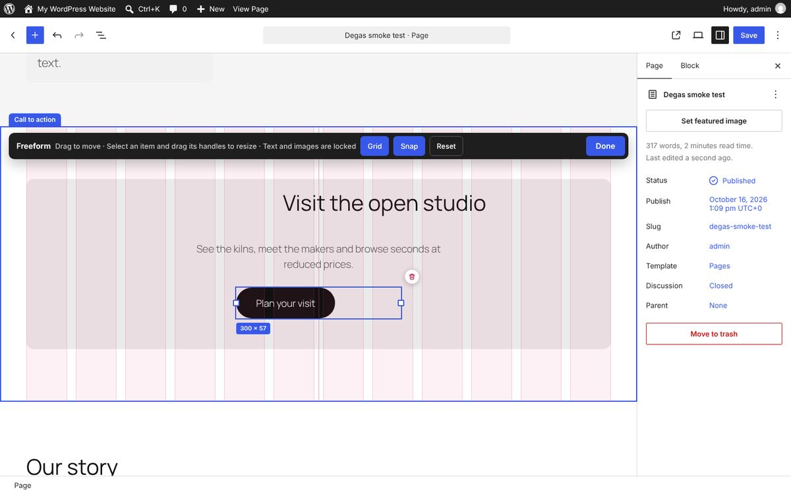

# Degas: section editing modes on real blocks

A WordPress plugin that brings [Albers](../albers/)' way of editing a page into the real editor. Hover a section to choose how you edit it, **Edit layout**, **Edit content** or **Freeform**, with an Add menu and a toolbar to move, duplicate and delete it. Everything it does is saved as ordinary block markup, so a page still loads, and still looks like its layouts, without anything Degas-specific in the way.

Requires WordPress 6.8 or later. Developed and tested on WordPress 7.1 with Twenty Twenty-Five, in the page and post editor and in the site editor (with or without the page's template shown).



## Try it

**[Try the live demo](https://automattic.github.io/site-editing-experiments/degas/)**, or **[open it full screen in WordPress Playground](https://playground.wordpress.net/?blueprint-url=https://raw.githubusercontent.com/Automattic/site-editing-experiments/trunk/degas/blueprint.json)**: a fresh, throwaway WordPress in your browser with Degas active and a sample page (Albers' Northfield Ceramics sections) open in the editor. Give it a minute to start, and use a desktop browser. Nothing is saved: closing or reloading the tab starts over.

The link runs [`blueprint.json`](blueprint.json), which installs the plugin straight from this repo's `trunk`. On any site with Degas active, `/wp-admin/?degas-sample` makes the same sample page and opens it.

## Sections

Every top-level block on a page is a section (inside Post Content, when the page is shown in its template). Degas adds twelve section types, the same as Albers: Hero, Features, Call to action, Text, Image, Gallery, Quote, Contact, FAQ, Team, Newsletter and Pricing. Each is an ordinary group of core blocks (headings, paragraphs, buttons, images and groups), and its type, layout and colours are class names on the section, such as `degas-section degas-hero degas-layout-cover degas-palette-night`. They're in the inserter as patterns too, under **Degas sections**.

Outside a mode the page's blocks are locked, as in Albers: you choose how to edit a section first. Only one section is in a mode at a time.

- **Add to a section:** **Add** in a section's top-left corner offers what suits it, such as a heading, paragraph, button, image or card, and puts it in the right place.
- **Add a section:** the **Add section** buttons on a section's top and bottom edges open a picker of the twelve types.
- **Move, duplicate, delete:** the toolbar in a section's top-right corner. Deleting shows a message with **Undo**.

Sections that aren't Degas types (any other group or block at the top of the page) get the overlay too: Edit content, Freeform, colours and the section toolbar all work on them; they just have no preset layouts.

## The three modes



- **Edit layout:** a panel at the top of the section offers its preset layouts, each previewed with a live miniature of the section's own content, and **Colours** switches between the palettes (Default, which keeps the theme's colours, Sand, Sage, Sky, Clay and Night). Extra layouts appear once there's enough content, marked with a blue dot: Image row for a hero with two images, Four columns for four feature cards, Two text columns for three paragraphs, Four across for eight gallery photos and four team members. Every item gets a bin, **Restore removed** brings items back, and **Reset** undoes everything since you opened the panel. Switching a layout only changes the section's class, so the content stays exactly as it is.
- **Edit content:** text becomes editable in place with the editor's own text toolbar, and images can be replaced from theirs. Nothing can be moved or added (the section's other blocks are locked using the editor's own content-only mode), but every item gets a bin, and **Restore** in the bar at the bottom of the section brings removed items back.
- **Freeform:** drag any item, and select one to resize it (images and cards from every side and corner, text from the left and right). A 12-column grid and pink snap lines show while you work, snapping to other items' edges and centres, the section's centre and its content edges. **Grid** and **Snap** turn those off, **Reset** puts every position and size back, Delete removes the selected item and the arrow keys nudge it (Shift for 10px).





## How it's saved

- **Layouts and palettes** are class names on the section block; `build/style-sections.css` (loaded on the site and in the editor) does the arranging.
- **Freeform positions** are a `degasFree` attribute on each moved block: `{ x, y, w, h }`, with x and w in percent of the section's content width and y and h in pixels. On the site they become CSS custom properties on the block's element (see `inc/freeform.php`), and they apply when the section is at least 600px wide. On phones the section falls back to its layout, which is always there underneath.
- Turn the plugin off and the blocks are still valid; sections lose their layouts' styling and freeform positions, and nothing else changes.

## What it doesn't do yet

- The site header and footer (template parts) aren't sections yet; Albers edits them like any section, with a note that they're on every page.
- Freeform has one position per item, used on desktop; there's no separate phone position, so phones always get the section's layout.
- The six gogh demo sites that Albers has as pages aren't here as starter content.
- Section names and the Add menu follow Albers; there's no way yet to add your own section types except the `degas_sections` filter.

## Running it

Build it once (the `build` folder is committed, so this is only needed after changes):

```
npm install
npm run build
```

Then run WordPress with the plugin, for example with WordPress Playground (it needs Node 24 or later):

```
npx @wp-playground/cli server --login --port=9400 \
  --mount=.:/wordpress/wp-content/plugins/degas
```

Activate **Degas (experiment)** under Plugins, add a page, and use **Add section**, or insert sections from the inserter's **Degas sections** patterns.

## Tests

`npm run test:e2e` drives the editor in a headless browser against the site above (or `DEGAS_BASE_URL`): it makes a page of all twelve section types, checks they load as valid blocks, goes through each mode, the Add menu, the section picker, moving, duplicating, deleting and undo, then saves and checks the published page. Set `DEGAS_SHOTS` to a folder to keep screenshots, and `DEGAS_CHROME` to use a particular browser.

## Files

- `degas.php`: loads the editor UI and the styles.
- `inc/sections.php`: the section types, their layouts and palettes, and the patterns. `inc/markup.php` writes the block markup.
- `inc/freeform.php`: freeform positions on the site.
- `src/editor/`: the overlay in the editor canvas (`layer.js`), Freeform (`freeform.js`), the Add menu's blocks and the layout previews (`pieces.js`), and how sections and items are read (`model.js`).
- `src/sections/style.scss`: layouts, palettes and freeform positions. `src/canvas/style.scss`: the editing chrome.

## Credits

The placeholder photos are the ones Albers uses, from [Unsplash](https://unsplash.com) under the [Unsplash License](https://unsplash.com/license).
