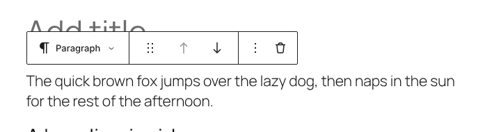
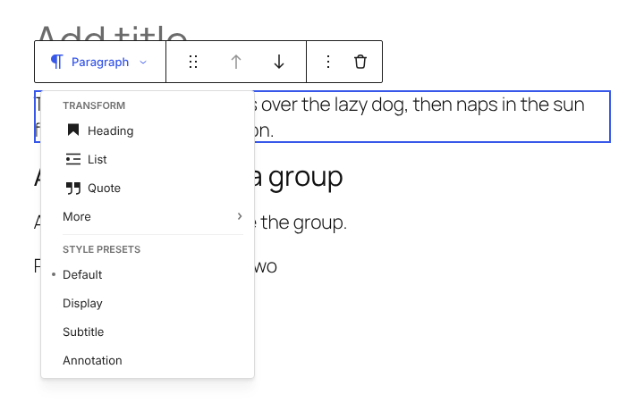
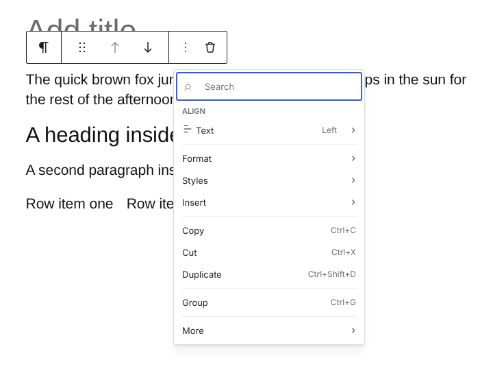
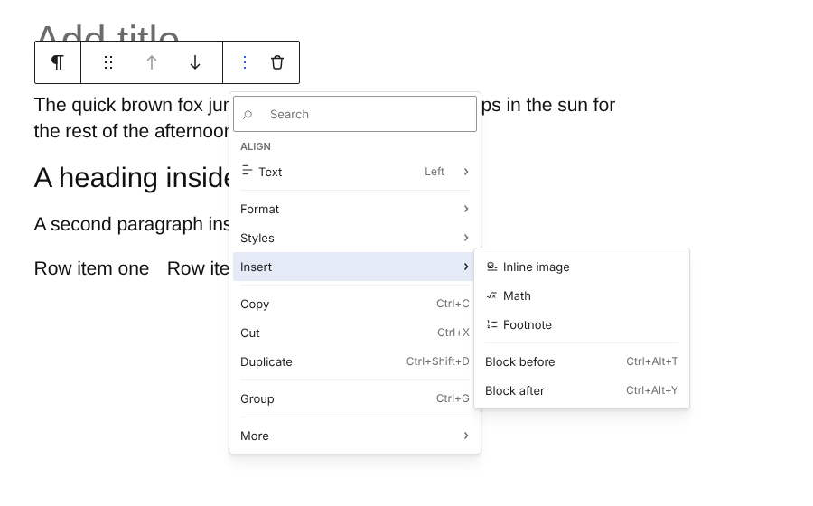
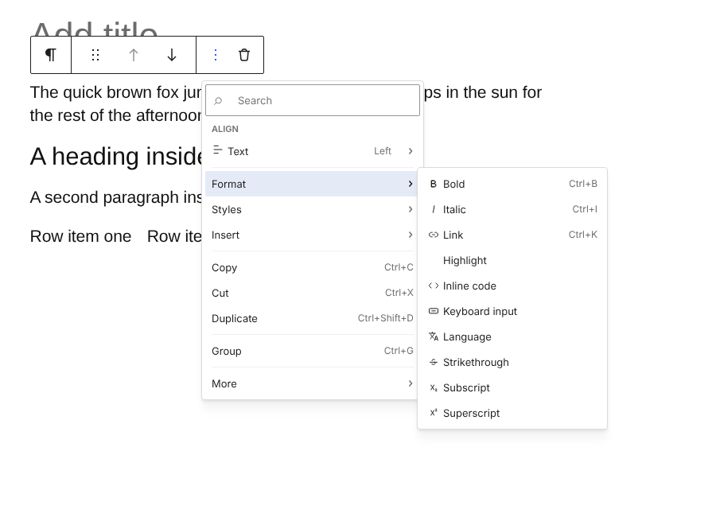
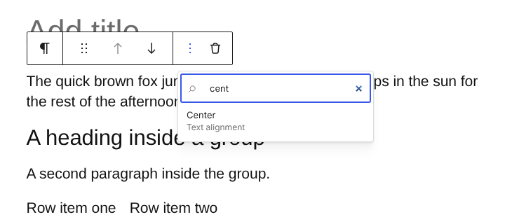
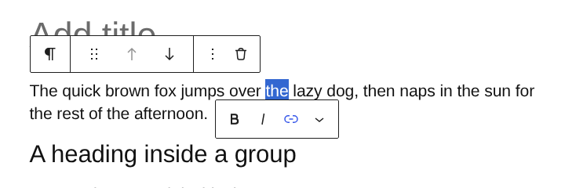
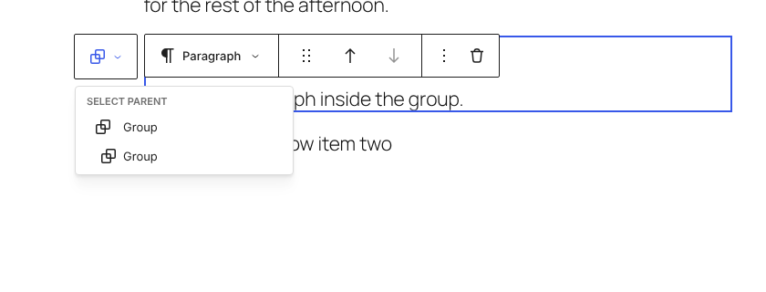
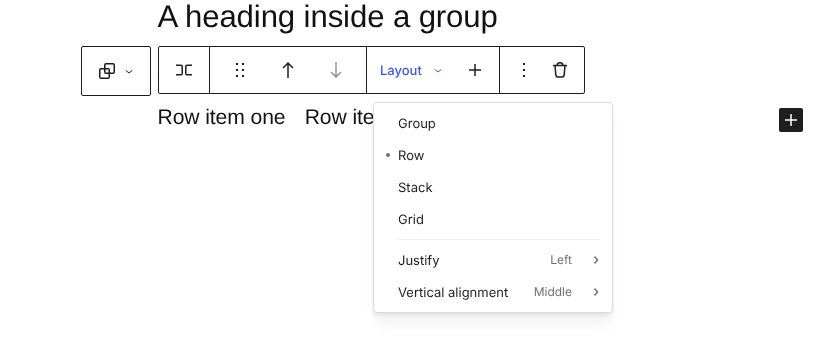
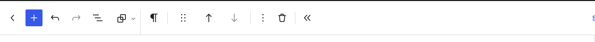

# Frankenthaler: one block toolbar, in a fixed order

Frankenthaler is a Gutenberg pull request rather than a static prototype: it changes the real block toolbar, behind an experiment, so it can be tried on real blocks, real themes and real plugins. **[Gutenberg PR](https://github.com/WordPress/gutenberg/pull/85187)**

## Try it

**[Try it in Playground](https://playground.wordpress.net/?blueprint-url=https://raw.githubusercontent.com/Automattic/site-editing-experiments/trunk/frankenthaler/blueprint.json)**. It installs the PR's latest build with the **Block toolbar redesign** experiment already on, and opens a sample post. Select a block to see the new toolbar; the site editor has it too.

Locally, check out the `try/block-toolbar-redesign` branch of Gutenberg, build it, and turn on the same experiment.

## Design principles

- **Style goes in the menu; structure stays top-level.** Style choices that usually come from Global Styles (text alignment, typography, block width) move to the options menu. Choices made for each block on its own (container layout, adding blocks inside) keep a place on the toolbar.
- **Icons are recognizable or labelled.** Icon-only buttons are for icons people know from across the web (bold, link, arrows, `+`, trash), and they still get a tooltip. Everything else has a visible text label.
- **The toolbar is always in the same place,** whatever the block hierarchy.
- **Block tools and text tools are separate.** Block tools act on the block. Formatting appears with a text selection.

## What's in it

The toolbar is always the same groups in the same order: **block name**, **movers**, **primary actions**, block controls from blocks and plugins, **options** (`⋮`) and **delete**.

### Block name

`Paragraph ⌄` shows what the block is and is the one place to change it: the three most used transforms, then More, then the block's style presets. A heading shows `Heading 2 ⌄`, and its levels are in this menu instead of a separate level dropdown.

### Options menu

One menu, every item labelled: **Align** (Text, and Block where the block supports it, with the theme's widths beside None and Wide), **Format**, **Styles** (copy and paste), **Insert**, Copy, Cut, Duplicate, Group, and **More** (Lock, Rename, Hide, Edit as HTML and any plugin items).

Inline insertion (inline image, footnote, math) moves out of formatting into **Insert**, beside Block before and Block after.

**Format** is kept as a fallback for now, so every format can still be reached from the block.

Start typing anywhere in the menu to search it. Results say where they live.

### Selection toolbar

Bold, Italic, Link and a More menu of other formats appear when text is selected, with the mouse or the keyboard, building on the toolbar image captions already use. It sits just below the selection, so it never covers the block toolbar above the block.

### Parent selector

The parent selector sits outside the toolbar, to its left, so the toolbar itself doesn't move when a block has a parent. Its menu lists the whole chain, outermost first.

### Primary actions

Containers keep a labelled **Layout ⌄** (Group, Row, Stack, Grid, then Justify and Vertical alignment) and a `+` that adds a block inside. Most other blocks leave this slot empty.

### Top toolbar

With Top toolbar on, the same groups sit in the top bar, with the parent selector first.

## Open questions

- **Third-party toolbar controls** still render in the toolbar, unlabelled. They could move into the options menu, a block's primary actions, or both, and they'd need a migration path and a way to declare a label.
- **Keyboard and mobile access to the selection toolbar.** It appears for keyboard selections, but there's no shortcut to move focus into it yet, and touch selection hasn't been tried.
- **Where the parent selector sits.** To the left of the toolbar for now; above it is the other option.
- **A preference to hide the movers,** and whether "Show button text labels" is still needed once every unfamiliar icon has a label.
- **Search** doesn't find Copy and Cut (the clipboard needs the click on the item itself) or plugin items.
- Zoomed out, content-only and placeholder toolbars keep the current design.

The PR also documents the toolbar groups for block authors and agents, as a "where should my control go?" guide, in `packages/block-editor/src/components/block-toolbar/redesign/README.md`.
