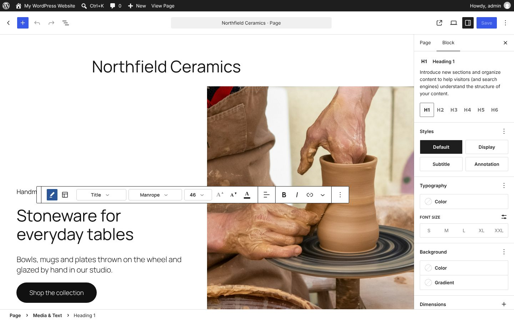
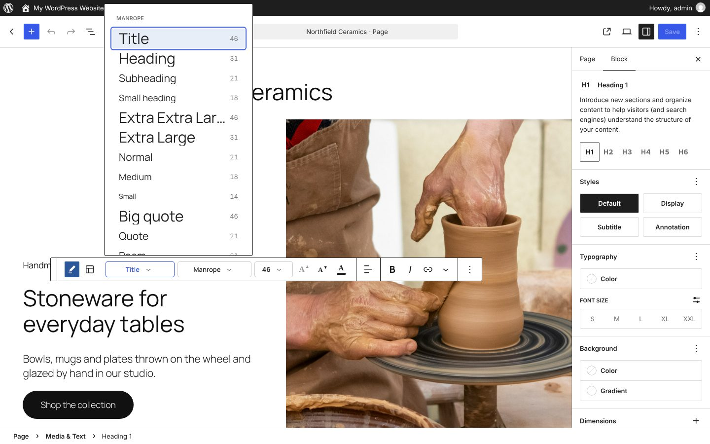
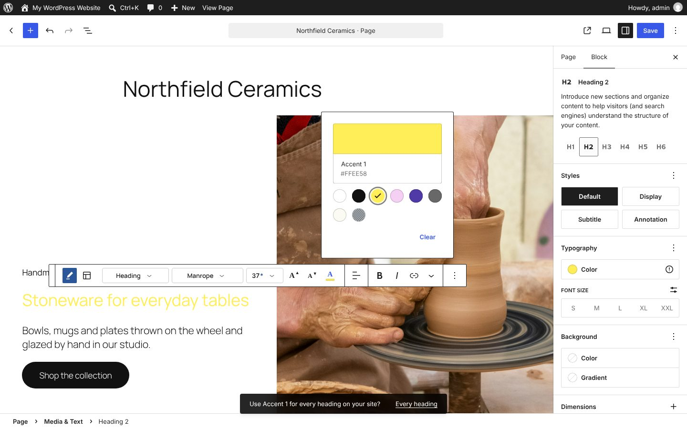
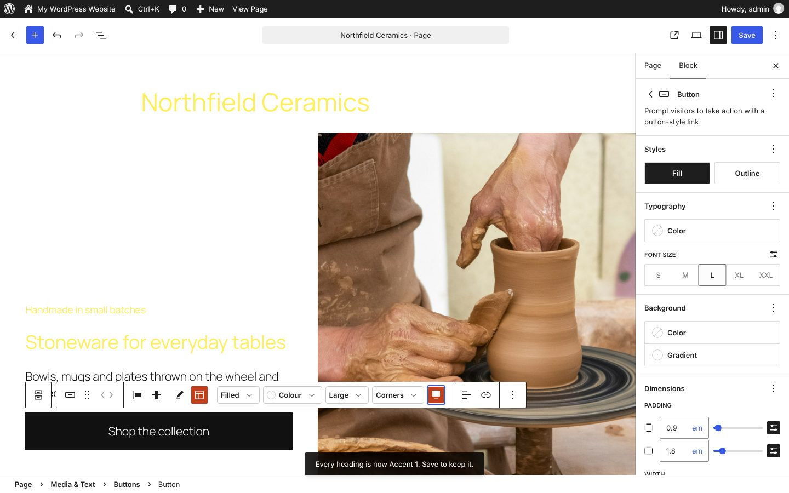

# Hepworth: writing and design toolbars in WordPress

A WordPress plugin that brings [Escher](../escher/)'s two toolbars into the real editor. In WordPress every block has one toolbar, and it's mostly set up for writing. Hepworth gives every block's toolbar a **Write / Design** switch at the start, and shows one of two sets of tools:

- a **writing toolbar**, inspired by Microsoft Word, for words: Style, Font, Size, bigger and smaller, font colour, and the editor's own bold, italic and links
- a **design toolbar**, inspired by Microsoft PowerPoint, for how things look and where they sit: the editor's own movers and drag handle, plus settings for buttons, pictures and sections

Requires WordPress 6.8 or later. Developed and tested on WordPress 7.1 with Twenty Twenty-Five, in the page editor.



## Try it

**[Try the live demo](https://automattic.github.io/site-editing-experiments/hepworth/)**, or **[open it full screen in WordPress Playground](https://playground.wordpress.net/?blueprint-url=https://raw.githubusercontent.com/Automattic/site-editing-experiments/trunk/hepworth/blueprint.json)**: a fresh, throwaway WordPress in your browser with Hepworth active and a sample page open in the editor. Give it a minute to start, and use a desktop browser. Nothing is saved: closing or reloading the tab starts over.

The link runs [`blueprint.json`](blueprint.json), which installs the plugin straight from this repo's `trunk`. On any site with Hepworth active, `/wp-admin/?hepworth-sample` makes the same sample page and opens it.

## Which toolbar

Text blocks (paragraphs, headings, quotes, poems, code and lists) open in the writing toolbar; everything else (buttons, pictures, groups and other sections) opens in the design one. The switch, always the first thing in the toolbar, changes it, with a pencil for writing and a layout icon for designing; hover either to see its name. The choice lasts while that block stays selected.

Each toolbar hides the other's controls:

- **Writing** hides the movers, the drag handle and the parent selector. The editor's block switcher becomes the block's icon as a simple menu: the block's name (Heading 1, say), then the names of the blocks it can turn into. Style, Font and Size do the same job in words people know.
- **Designing** hides bold, italic, links and the other text formatting, and the parent selector.

Alignment is split between them. **Align text** (left, centre, right) is about the words, so it's only in the writing toolbar. Where a block sits (**Align**: wide, full width or floated), how a row of buttons is justified and how columns line up vertically are about the layout, so they're only in the design toolbar. Blocks add these controls themselves with no class of their own, so Hepworth finds them by their labels, using WordPress's own translations of those words.

The selected block's outline takes the toolbar's colour: Word blue for writing, PowerPoint orange for designing.

## The writing toolbar



- **Style** lists every text style the theme offers, grouped by font, each shown in its own font and size with its size in pixels: Title, Heading, Subheading and Small heading; Normal and the theme's paragraph sizes; Big quote, Quote and Poem; Typewriter and Code.
- **Font** lists the theme's fonts, each written in itself.
- **Size** shows the sizes the current font comes in, and a box to type a size of your own. An asterisk marks a size of your own.
- **A▲** and **A▼** step to the theme's next size up or down, staying the same kind of block while there's a size left (heading levels, paragraph sizes).
- **Font colour** is Word's A with a colour bar: the theme's colours, or any colour of your own.

### Fonts and sizes are block transformations

There are no free-form fonts. Every style is a block, and the menus are built from the theme by drawing a hidden sample of each block in the editor canvas and reading back its font and size, so they show what the page will really look like.

| Style | Block underneath |
| --- | --- |
| Title, Heading, Subheading, Small heading | Heading, levels 1 to 4 |
| Normal, and the theme's paragraph sizes | Paragraph, with the theme's font size preset |
| Big quote | Pullquote |
| Quote | Quote |
| Poem | Verse |
| Typewriter | Preformatted |
| Code | Code |

Choosing a style uses the blocks' own transformations, going by way of a paragraph when there isn't a direct one, and keeps the words. Fonts are grouped by the font each block actually gets, so in a theme like Twenty Twenty-Five, where headings, paragraphs and quotes all use Manrope, Manrope's sizes run from Title down to Small print, and changing font moves to the nearest size in the other font. A size of your own is saved as the block's custom font size (`style.typography.fontSize`); typing a size the theme already has for that font picks that style instead.

## Colour for one, or for all of them



Changing the colour of a heading, some text, a quote, code or a button applies it straight away, then a message asks whether to use it for all of them: **Use Accent 1 for every heading on your site?** with **Every heading**. Ignoring it keeps the colour to that one block.

Saying yes sets the colour in the site's styles (Global Styles: the heading element, the paragraph and list blocks, the quote blocks, the code blocks, or the button element) and clears one-off colours of that kind on the page, so everything follows the new colour. The change to the site's styles is saved with the page; the editor's save panel lists it.

A section's background asks about **every section on this page** instead, and saying yes gives each section on the page that background.

## The design toolbar



Alongside the editor's own movers and drag handle:

- **Buttons:** **Style** (Filled or Outline), **Colour** (the fill, or an outline button's text and border, with the every-button question), **Size** (Small, Medium or Large), **Corners** (Round, Soft, Square or the theme's), and **Full width**.
- **Pictures:** **Shape**: Original, Landscape, Wide, Square, Portrait, Circle or Arch.
- **Sections** (groups, columns, media and text, and covers): **Background** (with the every-section question), **Spacing** (Compact, Comfortable or Spacious), and **Swap sides** for media and text and for two columns.

## Not done yet

This first version is the two toolbars. Escher's drag-anywhere, resize handles in column fractions and freeform sections aren't here; [Degas](../degas/) already does freeform sections on real blocks.

## Developing

```sh
npm install
npm run build      # or npm start to rebuild as you work
```

The built files in `build/` are committed so the Playground blueprint can install the plugin straight from GitHub. Run `npm run build` and commit `build/` with any change to `src/`.

### Testing

`e2e/smoke.mjs` drives the real editor in a headless browser through both toolbars on the sample page, checking the blocks they leave behind (it never saves). Start a WordPress with the plugin mounted, activate the plugin in Plugins, then run it:

```sh
npx @wp-playground/cli server --login --port=9400 \
  --mount=.:/wordpress/wp-content/plugins/hepworth
npm run test:e2e
```

`HEPWORTH_BASE_URL` points it at another site, `HEPWORTH_SHOTS` keeps screenshots in a folder, and `HEPWORTH_CHROME` uses a particular Chrome or Chromium.

The sample page's studio name and copy are invented placeholders, and the address is a bracketed placeholder. The photos are the same ones Albers and Degas use.
