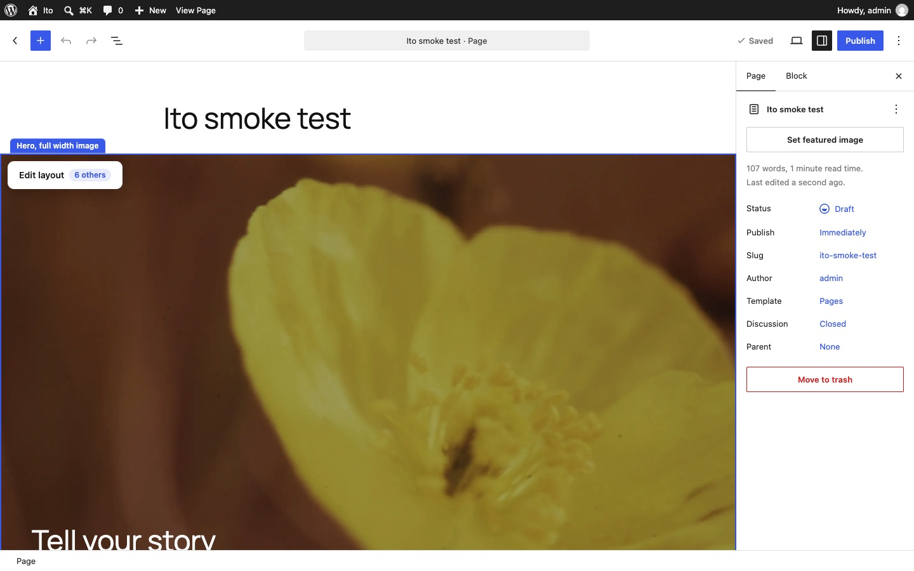
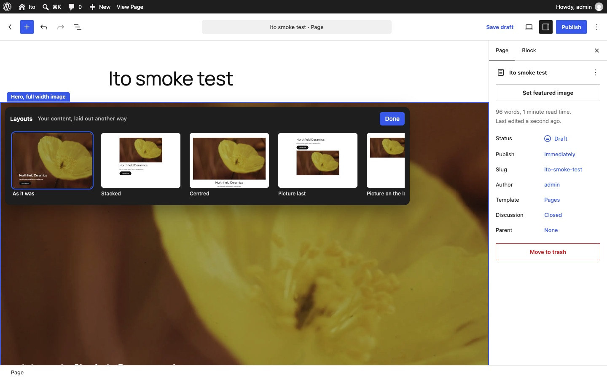
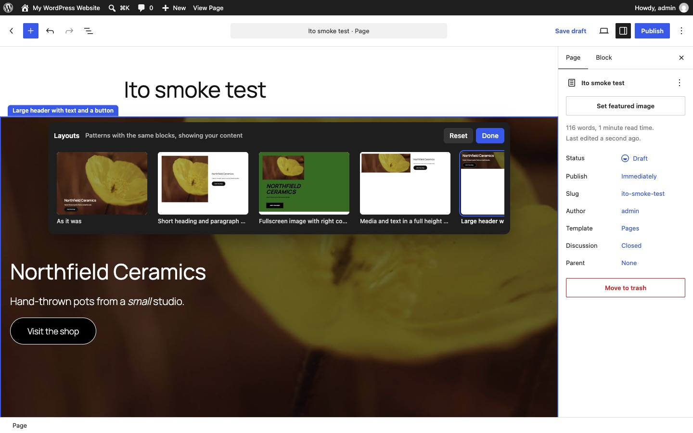

# Ito: swap a pattern, keep the content

A WordPress plugin that tries out [Albers](../albers/)' Edit layout with real patterns. Hover a section of a page and choose **Edit layout** to see it in every other registered pattern that has the same blocks, and in layouts made from the section's own content, each previewed with the section's own words and pictures. Pick one and the section changes to it: the layout and styling change, and the content stays. No content block is ever added or removed, so every section has a choice, whether or not a pattern matches it.

Unlike [Degas](../degas/), whose layouts are class names on its own twelve section types, Ito works with whatever patterns the site has (core's, the theme's and plugins'), and a swap really changes the blocks.

Requires WordPress 6.8 or later. Developed and tested on WordPress 7.1 with Twenty Twenty-Five, in the page and post editor.



## Try it

**[Try the live demo](https://automattic.github.io/site-editing-experiments/ito/)**, or **[open it full screen in WordPress Playground](https://playground.wordpress.net/?blueprint-url=https://raw.githubusercontent.com/Automattic/site-editing-experiments/trunk/ito/blueprint.json)**: a fresh, throwaway WordPress in your browser with Ito active and a sample page open in the editor. Give it a minute to start, and use a desktop browser. Nothing is saved: closing or reloading the tab starts over.

The link runs [`blueprint.json`](blueprint.json), which installs the plugin straight from this repo's `trunk`. On any site with Ito active, `/wp-admin/?ito-sample` makes the same sample page and opens it. It's four Twenty Twenty-Five patterns that each have at least one other pattern with the same blocks: a full-width hero (four others), a heading and paragraph beside an image, a cover with a big heading, and a centred call to action.

## Editing a section's layout

Every top-level block on a page is a section (inside Post Content, when the page is shown in its template).

- **Hover a section** for a blue outline, its name in a tab above it (the pattern's title when it came from one) and **Edit layout** at the top, with how many other layouts there are.
- **Edit layout** opens a panel at the top of the section, which stays in view as you scroll a tall one. Its first row shows the section **As it was**, then every matching pattern; its second row, **Arranged from your content**, the generated layouts. Each is a live preview of the section's own content.
- **Pick a layout** and the section changes underneath, straight away. You can go through them all: each one starts from the section as it was when you opened the panel.
- **Reset** puts the section back as it was. **Done**, Escape, or a click anywhere else on the page closes the panel (a click on the page does nothing else).
- Each swap is one step of the editor's undo.

Outside the panel, the page edits as usual: Ito only takes the pointer on its own controls.



## Which patterns match

Two patterns match when they have the same **content blocks in the same order**, whatever arranges them. Ito reads a section from top to bottom and lists:

- Headings, paragraphs, buttons, lists, quotes and anything else that's content, by block type. A list counts once, however many entries it has.
- **Pictures** as "image", whether they're an Image block, a Cover's background or a Media & Text's media. So a split hero with an image beside the words matches a cover hero with the same words over the photo.

It looks through the blocks that only arrange others (Group, Row, Stack, Columns, Column and Buttons) and leaves out Spacers, Separators and Covers without a picture. So a heading, a paragraph and a button match the same three in two columns, but not a paragraph before a heading, or three feature cards against four.

A pattern can only be swapped to if it's a single top-level block and none of its content comes from the site: patterns with posts (Query Loop), the site title or logo, navigation, template parts or synced patterns are left out. The section's own pattern isn't offered again, since it's **As it was**.

With Twenty Twenty-Five and core's patterns, 74 of the 130 can be swapped to, but most have blocks no other pattern shares. 22 have at least one other pattern with the same blocks, in nine groups. The biggest is five heroes made of a picture, a heading, a paragraph and a button; the other eight are pairs or a trio.

## Layouts made from the content

Most patterns have blocks no other pattern shares, so Ito also makes layouts from the section itself. It takes the section apart into its content, in order (its pictures, and its headings, paragraphs, buttons, lists, quotes and so on), and puts the same blocks back in new layout blocks: groups, columns, button rows and covers. The content blocks are used exactly as they are, attributes and all; only the blocks around them, and sometimes where they sit, change.

| Layout | When it's offered |
| --- | --- |
| Stacked | Always: everything in one column, in order |
| Centred | Always: the same, centred |
| Picture first, or Picture last | One picture: moved to the other end |
| Picture on the left, or on the right | One picture: in two columns, beside everything else |
| Picture behind | One picture without a caption or link: as a Cover, with the rest over it |
| Two columns | No pictures: the first heading on top, the rest in two columns |
| Card | Always: in a rounded, tinted panel |

They're plainer than designed patterns, and take their spacing from the theme's sizes. A section with a generated layout is no longer a pattern, so it's named by its block.

## What moves across

The new pattern supplies the blocks and everything about how they look: groups and columns, colours, fonts and sizes, spacing, alignment, image aspect ratios and duotone, button styles. The section supplies the content, slot by slot in order:

| Block | What comes from the section |
| --- | --- |
| Heading | Text, with its formatting and links, and **the heading level**, so the page's outline doesn't change |
| Paragraph | Text, with its formatting and links |
| Button | Text, link, and whether it opens in a new tab |
| Picture | The image, its alt text and media library ID, into whichever of Image, Cover and Media & Text the pattern uses; for Image to Image, the caption and link too |
| List | Every entry, and whether it's numbered; the pattern's list style stays |
| Quote | The citation (its paragraphs move like any others) |
| Anything else | The whole block, as it is |



## How it's saved

A swap replaces the section with the new pattern's blocks, so it's saved as ordinary block markup. The section's top block records which pattern it is in `metadata.patternName`, as the inserter does, which is how Ito names it and knows which pattern it already is. Turn the plugin off and nothing changes on the page.

## What it doesn't do yet

- Only exact matches with registered patterns: a section with one more paragraph, or one fewer button, than a pattern can't use it. Generated layouts fill the gap; adapting a nearly matching pattern (dropping its unused slots, or placing an extra block beside one like it) would bring more of the theme's designs in.
- Some groups of matching patterns are small or odd, because the theme's patterns weren't written to share structure. A family of patterns made to match would give more choice.
- The section's own colours or styles, if you changed them, are replaced by the new pattern's.
- Headers, footers and the site editor's templates aren't sections.
- The previews show at most five or so across; the rest scroll sideways.

## Running it

Build it once (the `build` folder is committed, so this is only needed after changes):

```
npm install
npm run build
```

Use npm 11 or later: npm 10 can't work out `@wordpress/scripts`' optional dependencies (`npx npm@11 install` works too).

### Tests

The matching and the moving of content are in [`src/editor/swap.js`](src/editor/swap.js), with unit tests beside them:

```
npm run test:unit
```

The smoke test drives the real editor in a headless browser: the sample page, hovering, the previews, every swap of the hero (checking its heading, level, paragraph, button and photo each time), every generated layout of it (checking that its content blocks are unchanged and it saves as valid markup), Reset, closing the panel, undo, publishing, and reopening. It needs a WordPress site with Ito active and automatic login, which WordPress Playground gives you:

```
npx @wp-playground/cli server --login --port=9400 \
  --mount=.:/wordpress/wp-content/plugins/ito
npm run test:e2e
```

Activate the plugin first (or start the server with a blueprint that does). Set `ITO_BASE_URL` to use another site, `ITO_SHOTS` to a folder to keep screenshots, `ITO_CHROME` to use a particular Chrome or Chromium, and `ITO_KEEP` to keep the page it makes.
