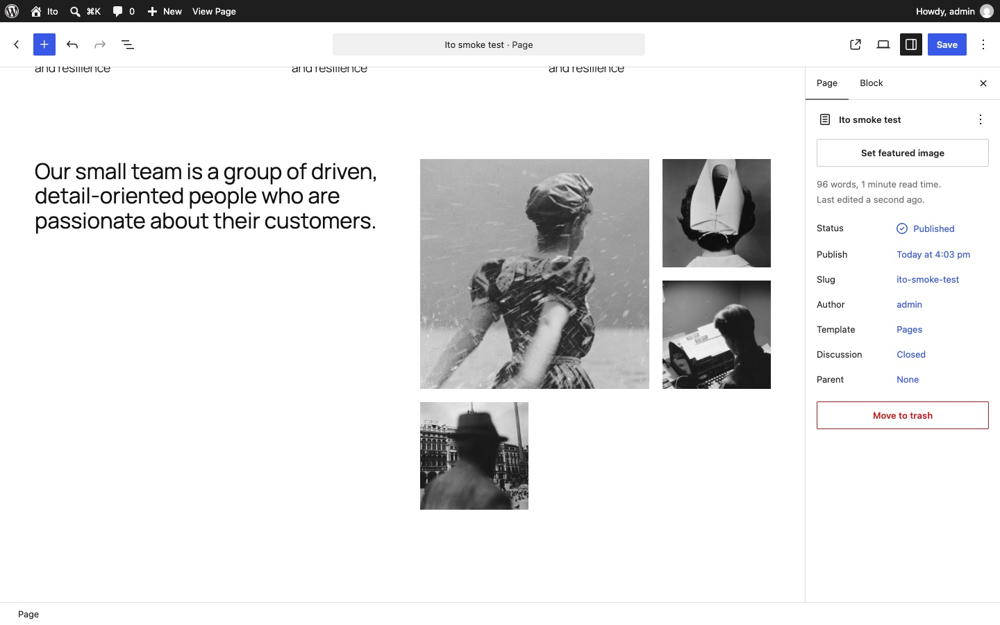

# Ito: change the layout, keep the content

A WordPress plugin that tries out [Albers](../albers/)' Edit layout on real blocks. Hover a section of a page and choose **Edit layout** to see it in other layouts made from its own content, each previewed with the section's own words and pictures. Pick one and the section changes to it, and the panel closes: the layout changes, and the content stays. No content block is ever added or removed.

Unlike [Degas](../degas/), whose layouts are class names on its own twelve section types, Ito works with whatever a section is made of, wherever it came from, and a new layout really changes the blocks.

Ito began by swapping a section to other registered patterns with the same content blocks. Too few patterns overlap for that to be useful: with Twenty Twenty-Five and core's patterns, only 22 of the 74 that could be swapped to had a match, mostly in pairs. So it now only makes layouts from the content.

Requires WordPress 6.8 or later. Developed and tested on WordPress 7.1 with Twenty Twenty-Five, in the page and post editor.


## Try it

**[Try the live demo](https://automattic.github.io/site-editing-experiments/ito/)**, or **[open it full screen in WordPress Playground](https://playground.wordpress.net/?blueprint-url=https://raw.githubusercontent.com/Automattic/site-editing-experiments/trunk/ito/blueprint.json)**: a fresh, throwaway WordPress in your browser with Ito active and a sample page open in the editor. Give it a minute to start, and use a desktop browser. Nothing is saved: closing or reloading the tab starts over.

The link runs [`blueprint.json`](blueprint.json), which installs the plugin straight from this repo's `trunk`. On any site with Ito active, `/wp-admin/?ito-sample` makes the same sample page and opens it. It's four Twenty Twenty-Five patterns that show the range of layouts: a full-width hero with one picture, three services in columns, team photos in a grid, and a centred call to action.

## Editing a section's layout

Every top-level block on a page is a section (inside Post Content, when the page is shown in its template).

- **Hover a section** for a blue outline, its name in a tab above it (the pattern's title when it came from one) and **Edit layout** at its top left, with how many other layouts there are. When the section is selected, Edit layout sits just below the editor's block toolbar.
- **Edit layout** opens a panel at the top left of the section, which stays in view as you scroll a tall one. It shows the section **As it was**, then every layout made from its content, each a live preview.
- **Pick a layout** and the section changes to it, and the panel closes. **As it was** leaves the section alone.
- **Done**, Escape, or a click anywhere else on the page closes the panel without changing anything (a click on the page does nothing else).
- Each change is one step of the editor's undo, so undo takes it back.

Outside the panel, the page edits as usual: Ito only takes the pointer on its own controls.


## Layouts made from the content

Ito takes the section apart into its content, in order, and puts the same blocks back in new layout blocks: groups, columns, button rows and covers. The content blocks are used exactly as they are, attributes and all; only the blocks around them, and sometimes where they sit, change.

- **Content** is headings, paragraphs, buttons, lists, quotes and anything else that isn't only there to arrange other blocks. A list counts once, however many entries it has.
- **Pictures** count as one item, whether they're an Image block, a Cover's background or a Media & Text's media.
- **Layout blocks** (Group, Row, Stack, Columns, Column and Buttons) are looked through, and Spacers, Separators and Covers without a picture are left out.

| Layout | When it's offered |
| --- | --- |
| One fewer, or one more, column | Alike cards: Columns blocks whose columns all hold the same kind of content, such as three services or two rows of quotes. The section keeps its design; the cards wrap into rows of the new number, and the last row is filled up with empty columns. From 1 to 6 columns |
| Grid shapes: every number across (*2 × 3 grid*), *Featured, 3 across* or *4 across*, and *Banner, then N across* | Any grid, whatever its cells. Only the grid changes: its number across, and the first cell's span (two by two for featured, the full width for a banner, over rows the rest fill exactly). A first cell that's a content block, such as an image, is put in a group that spans, so the block itself doesn't change. The grid's current shape isn't offered |
| Stacked | When something is side by side or there's a cover: everything in one column, in order. Also when no other layout applies, so every section has a choice |
| Centred | Six content items or fewer, with nothing side by side: the same, centred |
| Picture first, or Picture last | One picture: moved to the other end |
| Picture on the left, or on the right | One picture: in two columns, beside everything else |
| Picture behind | One picture without a caption or link: as a Cover, with the rest over it. The Cover keeps the section's alignment, name and spacing, but not its colours or fonts |
| Split in two | No pictures: the first heading on top, the rest in two columns |
| Card | Six content items or fewer, with no cover, and not already a Card: in a rounded, tinted panel |

A grid shape sets the number across exactly, so it drops a grid's minimum column width, which would otherwise let it show fewer. Like any grid with a set number of columns in WordPress, it keeps that number on a narrow screen.

### The section's own design

A layout changes how the content is arranged, not how the section looks. The block around the content keeps the section's colours, fonts, border, spacing, content width, classes and name, and groups that only hold another group stay as they are, with the layout made inside the last one. A section with no padding of its own, in any of those groups, gets some from the theme's sizes.

A section that isn't a group hands on what a group can use: a Columns or Media & Text block its colours, fonts and spacing, and a Cover only its alignment, classes, name and spacing, as its text was chosen to sit on its picture. Block styles are left behind, as they belong to one kind of block. A content block's own style stays on the block.



## How it's saved

A new layout replaces the section with new blocks, so it's saved as ordinary block markup. A section from a pattern records that in `metadata.patternName`, as the inserter does, and Ito shows the pattern's title as its name. A new layout drops that, as the section is no longer the pattern, so it's named by its block. Turn the plugin off and nothing changes on the page.

## What it doesn't do yet

- Generated layouts are arrangements, not designs: they keep the section's look, but don't add new styling of their own, other than Card's panel.
- A Cover's height and overlay aren't kept when its picture moves out of it, so they don't come back if you put it behind again.
- Headers, footers and the site editor's templates aren't sections.
- The previews show at most five or so across; the rest scroll sideways.

## Running it

Build it once (the `build` folder is committed, so this is only needed after changes):

```
npm install
npm run build
```

Use npm 11 or later: npm 10 can't work out `@wordpress/scripts`' optional dependencies (`npx npm@11 install` works too).

### Tests

The layouts are in [`src/editor/layouts.js`](src/editor/layouts.js) and reading a section's content in [`src/editor/content.js`](src/editor/content.js), with unit tests beside them:

```
npm run test:unit
```

The smoke test drives the real editor in a headless browser: the sample page, hovering, the previews, that no registered pattern is offered, every layout of the hero (checking that its content blocks are unchanged and it saves as valid markup), that picking closes the panel, As it was, closing the panel, undo, publishing, reopening, taking Twenty Twenty-Five's three services to two and four columns, its 2 × 2 team photos to 1 × 4, featured and banner shapes (checking the columns and spans the canvas draws), and that every layout of a section with a background still draws it. It needs a WordPress site with Ito active and automatic login, which WordPress Playground gives you:

```
npx @wp-playground/cli server --login --port=9400 \
  --mount=.:/wordpress/wp-content/plugins/ito
npm run test:e2e
```

Activate the plugin first (or start the server with a blueprint that does). Set `ITO_BASE_URL` to use another site, `ITO_SHOTS` to a folder to keep screenshots, `ITO_CHROME` to use a particular Chrome or Chromium, and `ITO_KEEP` to keep the page it makes.
