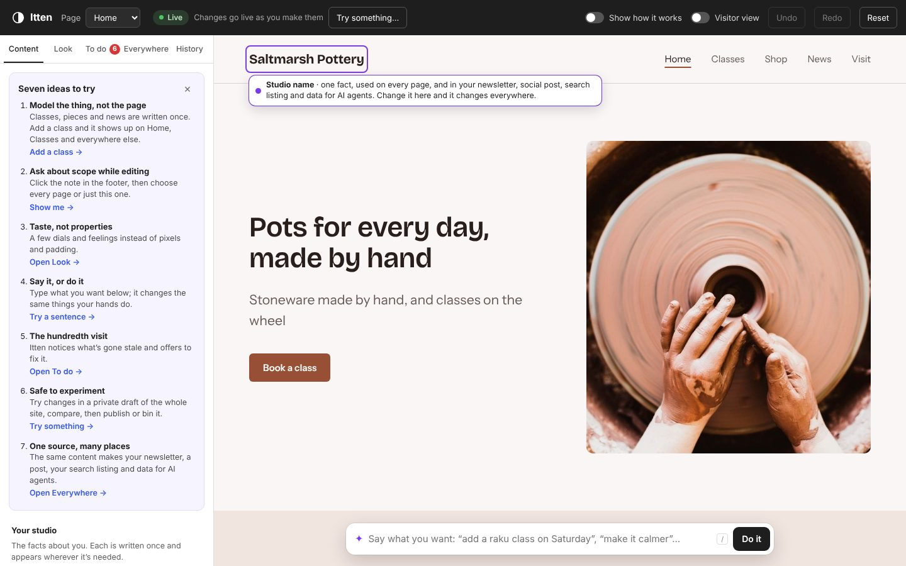

# Itten: making a website from first principles

The other experiments here improve the site editor we have. Itten starts again and asks what a website is to the person making it. To the software it's templates, template parts, blocks, global styles and query loops. To a potter it's "people can see what classes are on, buy a mug and find out when we're open, and it feels like us."

Itten is a prototype of a site maker built from that side, for an invented pottery studio. It explores seven ideas at once. Each would need its own study before it went anywhere near the real editor.

**[Try it](https://automattic.github.io/site-editing-experiments/itten/)** on a computer.

## The seven ideas

### 1. Model the thing, not the page

Most sites have a model of the thing they're about underneath. A band has releases and gigs; a café has a menu and opening hours; a pottery studio has **classes**, **pieces in its shop**, **news**, and **facts** like its name, address and hours.

In Itten you write each of these once, in the **Content** panel or by clicking it on the page, and pages are **views** over them. The homepage's "Coming up" section isn't a list someone keeps up to date; it's "the next three classes", so adding a class puts it there, and on the Classes page, the newsletter, the search listing and the data for AI agents. Classes that have happened drop out of "Coming up" by themselves. Sold pieces get a Sold badge, or disappear, depending on how the view is set up.

Every class, piece, news post and fact tells you where it's shown ("Shown on Home and Classes, and in your newsletter…"), worked out by rendering every page and output and looking.

WordPress has all of this underneath (post types, queries, templates), but makes people build the views by hand. Itten flips it: you own the content, and the system takes care of the structure unless you want to change it.

### 2. Ask about scope while editing

Templates exist to answer "where does this change apply?" The site editor answers it by making you go somewhere first: the page, the template or the template part. Itten lets you edit exactly what you see and answers the question at the moment you edit, with a small label above the text:

- **Text on this page** (blue): "Home · this text is only on this page".
- **A fact** (purple), like the studio name, tagline or address: "Studio name · one fact, used on every page, and in your newsletter…". The other places it appears on the page are outlined and change as you type.
- **Something shared** (orange), like the footer note: "Footer note · change it on **Every page (5)** | **Just Home**". Choosing Just Home gives that page its own note; choosing Every page again puts it back on the shared one.

There's no template to find. The question comes to you.

### 3. Taste, not properties

Hardly anybody wants to set 32px of padding. They want "more breathing room", "calmer" or "like a gallery". The **Look** panel has:

- **Start from a feeling**: six looks (Workshop, Gallery, Corner café, Journal, Seaside, Market stall). Hover to try one on the page; click to keep it.
- **Fine-tune**: two dials, **Space** (snug to airy) and **Mood** (calm to lively), three **Type** pairings (Modern, Classic, Friendly) and six **Colours**.
- **Or just say it**: More breathing room, Calmer, Livelier, Make it feel more premium, and so on.

Underneath is a design system, generated from the dials: colours from a single hue (with button text that flips between dark and light to keep its contrast), a type scale whose ratio grows with mood, section spacing and gaps from space, and corners that get rounder as things get livelier. Turn on **Show how it works** to see the tokens. It's always coherent, because nobody sets the pieces one at a time.

### 4. Say it, or do it

The bar along the bottom (press `/`) takes plain sentences, and changes the same model your hands do. Each change says what it did and where it shows up, with **Undo**. It understands things like:

- "Add a class called Raku firing on Saturday at 2pm for £65", or "add a raku class next Friday"
- "Make it feel more premium", "more breathing room", "make it green", "calmer and warmer"
- "Mark the tea bowl as sold", "hide sold pieces"
- "We're closed on Mondays", "open Sundays 11 to 4", "We're closed 24 December to 2 January"
- "Add a booking section", "remove the shop section"
- "Post: Seconds sale this weekend", "Add a page called Gallery", "Rename the studio to …"
- "Go to classes", "show me the newsletter", "undo"

It's a small rule-based interpreter standing in for a language model; it doesn't call one. The point isn't the parsing: it's that words and direct manipulation share one model, so you can say roughly what you want and then fix the details by hand.

### 5. The hundredth visit

Most work on a site isn't building it; it's keeping it true. The **To do** panel notices what's gone stale and offers to fix it:

- classes that have already happened but are still listed
- fewer classes coming up than the homepage has room for
- sold pieces still in the shop
- copy that mentions the wrong season ("Your news mentions summer, and it's November")
- opening hours nobody has checked for six months
- in November and December, whether you're open over Christmas

The sample's dates are set relative to today, so these always have something to find.

### 6. Safe to experiment

People in user research keep saying they're scared of breaking their site. In Itten:

- **Try something…** makes a private **draft** of the whole site. The stage gets a yellow edge and the top bar says visitors still see the live site. **Compare** shows live and draft side by side, scrolling together; **Publish** or **Throw away** finishes it.
- **History** lists every change by name. Click one to see the site as it was then, and **Bring this back** if you want it. Bringing something back is a change too, so it can be undone.
- **Undo** and **Redo** (Ctrl+Z, Ctrl+Shift+Z) cover everything, including publishing, and so does **Reset**.

### 7. One source, many places

A website is one way of showing your content. **Everywhere** shows four others made from exactly the same things, which update as you edit:

- a **newsletter**, with the latest news, the next classes and new pieces, in your look
- a **social post** for the next class, with a caption
- a **search listing**, with an "open now" line worked out from your hours (your facts travel here; your look doesn't)
- **data for AI agents**: the schema.org JSON-LD a page would publish, and a few questions an assistant could now answer ("Is it open on Mondays?", "Can I buy a mug there?")

## Other things to try

- **Hover a section** for its name, Settings (how many items a view shows, whether it includes past classes or sold pieces, and its background), move up and down, and Remove. **+ Add a section** at the bottom of each page.
- **Click a class, piece or news post** on the page to edit it in place, **click opening hours** anywhere to change them, and **click a big picture** to swap it.
- **Visitor view** turns editing off so the menu and buttons work like a real site.
- **Show how it works** labels every section with what it's made of (a view of your classes, shared on every page, and so on) and underlines facts and shared text.

## Running it

It's plain HTML, CSS and JavaScript with no build step, and it uses the photos from `../albers/images/`. Serve the repository root with any static server and open `itten/`. Nothing is saved: reloading starts again.

The studio and its copy are invented, and names, addresses and contact details are bracketed placeholders.
