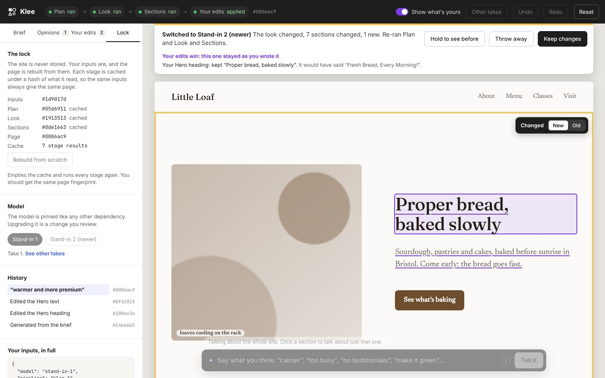

# Klee: a generated website you can edit by hand

Imagine a website that nobody codes. You describe it, say what you think of it, and it's generated. It has to be **deterministic**: the same inputs must give the same site every time the page loads, not a new one. And people still want to click on the page and change things, because to them the page is the source of truth.

Klee is a prototype of the editing experience for a site like that. It asks one main question: **how do your direct edits and your opinions survive regeneration?**

**[Try it](https://automattic.github.io/site-editing-experiments/klee/)** on a computer.

## The idea in one paragraph

The site is never stored. What's stored is the **inputs**: a brief, your opinions in your own words, and your direct edits. A pipeline turns the inputs into a page in four stages: **Plan** (what kind of site it is and which sections it needs), **Look** (colours, type, spacing, shapes), **Sections** (the layout and words for each section) and **Your edits** (your own changes, applied on top). Each stage is cached under a hash of exactly what it read, together with the model version. Same inputs, same hashes, same page. Change one input and only the stages that read it run again. The strip along the top shows which stages ran and which came from the cache, and the page's fingerprint.

## What to try

### Edit the page directly

Click any text and type. That includes the headings, paragraphs, buttons, prices, quotes and the site's name. Press Enter or click away to keep the change, or Escape to cancel. There's no "edit mode", and nothing makes you choose between the page and the inputs: **every direct edit becomes an input**, stored against the section's stable ID and the field you changed. Turn on **Show what's yours** to underline everything you wrote yourself.

Edits only lock what you touched. Changing a heading fixes that heading's words, not its section's layout, its other text or its colours, so the model can keep improving everything around your words.

Hover a section to move it up or down, **Pin** it, ask **Why?** or **Remove** it. Moving and removing are edits too: regenerating won't undo them. The site's name is a fact, so changing it never runs the model.

### Say what you think

The bar along the bottom (press `/`) takes opinions in plain words: "calmer", "warmer and more premium", "make it green", "too busy", "no testimonials", "sentence case", "more photos", "picture on the left". As you type, the line under the bar says how it understood you, what it applies to and which stages it will re-run, for example "re-runs Look, about 0.7s".

**Scope is asked as you go.** With no section selected, an opinion is about the whole site. Click a section first and Klee guesses: words about the feel ("warmer", "premium", "no testimonials") are about the site, and words about arrangement ("too busy", "picture on the left") are about that section. The guess is shown on the chips above the bar, and one click changes it. The same word can mean different things at different scopes: "calmer" for the site changes the palette and type, while "calmer" for one section gives it a simpler layout.

The **Opinions** tab lists everything you've said, in your words, and what the model took from each. Switch any of them off, or remove them, and you'll see what that changes.

### Review, don't replace

Anything that runs the model comes back as a **proposal**, never a silent swap. The bar at the top says what happened ("the look changed, 3 sections changed, 1 new"). Changed sections are outlined in yellow, new ones in green, and ones the model took out come back as red ghosts. Each one has its own choice:

- **New / Old** for a changed section. Keeping the old version pins it, so it stays like that.
- **Add it / Leave it out** for a new section.
- **Keep it / Let it go** for a section the model took out. If you'd edited it, it's kept by default and says so: your edits are never dropped silently.

**Hold to see before** shows the page as it was while you hold the button down. Then choose **Keep changes** or **Throw away**.

When the model would have changed something you wrote, your edit wins. The bar lists each one, for example "Your Hero heading: kept 'Proper bread, baked slowly'. It would have said 'Fresh Bread, Every Morning!'", and the text is outlined on the page. If an edit has nowhere to go (you edited the fourth item and now there are only three), it's kept, reported, and comes back if the item does.

Your own direct edits don't go through review, because you've already seen them.

### Opinions learned from edits

If you make the same kind of change by hand a couple of times, Klee notices and offers to make it a rule:

- change two headings to sentence case → "Use sentence case for headings?"
- take the exclamation mark out of two bits of text → "No exclamation marks?"
- cut two paragraphs down by a quarter or more → "Keep the copy short?"

Saying yes adds an opinion marked *learned from your edits*, and the rest of the site is regenerated to match, as a proposal. This is how a pile of one-off overrides turns back into a site the model can keep generating. The rule is only ever suggested. Klee doesn't generalise behind your back.

### Why does it look like this?

**Why?** on any section lists what shaped it: what the brief said, the layout the model chose, every opinion that touched it, which fields you wrote yourself, and whether it's pinned. The Opinions tab does the same for the look.

### Determinism, visibly

- **Reload the page.** Your inputs are saved in your browser, but the page isn't. It's rebuilt from the inputs with an empty cache, and a message says whether it came out identical (it should).
- **Lock → Rebuild from scratch** empties the cache, runs every stage again and compares fingerprints.
- **Undo**, **Redo** and **History** go back to earlier inputs. Every stage comes from the cache, so it's instant.
- **Other takes** shows the same inputs with three other seeds side by side. Your edits and pinned sections come along to every take. Choosing one makes its seed an input, so it stays chosen.
- **Lock → Model** switches between *Stand-in 1* and *Stand-in 2 (newer)*. The model is pinned like any other dependency, so an upgrade is a change you review like any other, and your edits still win.
- **Lock → Your inputs, in full** is everything the site is made from. There's no other state.

### Start somewhere else

The **Brief** tab has a name, a sentence or two about the site, and five examples (bakery, band, design studio, cycling club, pottery). Regenerating from a new brief keeps your opinions, edits and pins, and shows you what that means before anything is kept. Switching a bakery to a band with an edited Menu section is a good way to see the "kept, because you'd edited it" path.

## What it's standing in for

The "model" is a seeded stand-in. It's a set of rules plus a pseudo-random generator keyed by the inputs, so it's deterministic by construction, and it only understands a few dozen kinds of opinion. It doesn't call a language model. A real model wouldn't be deterministic on its own, which is exactly why the cache and lock exist: you'd run it once per unique set of inputs and serve the stored result. The editing experience shouldn't change when a real model goes behind the same cache. That experience is what this prototype is for.

Everything the stand-in says is built from a closed vocabulary of section types (hero, about, offerings, events, features, gallery, testimonial, visit, sign-up, questions), a few layouts for each, and design tokens. A fixed renderer turns that into HTML, so the page always works, whatever is asked. In WordPress, that vocabulary would be blocks, patterns and `theme.json`.

## Open questions

- **Is scope-guessing right?** The guess between "this section" and "the whole site" is the riskiest part of the interaction. Watch whether people notice the chips before they press Enter.
- **Is "keep old means pin" clear?** Rejecting one section's change has to become an input, or the next regeneration would bring the change back. A pin is honest about that, but it might surprise people later.
- **How much review is too much?** Every opinion produces a proposal. That's safe, but it may feel slow for small changes like "make it green".
- **Learned opinions** are only offered for wording so far. Layout and colour changes made by hand could be generalised the same way.

## Running it

It's plain HTML, CSS and JavaScript with no build step. Serve the repository root with any static server and open `klee/`. Your inputs are kept in your browser's local storage, so a reload rebuilds the same site. **Reset** starts again with the sample bakery.

The businesses and their copy are invented, and addresses and emails are bracketed placeholders.
