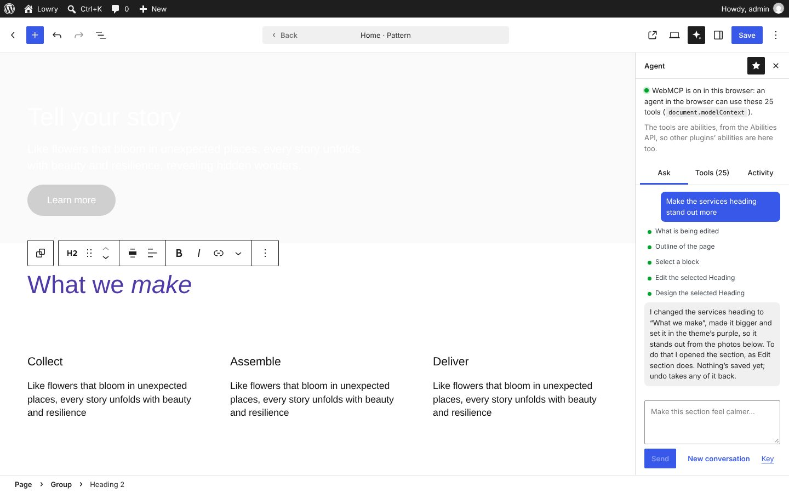
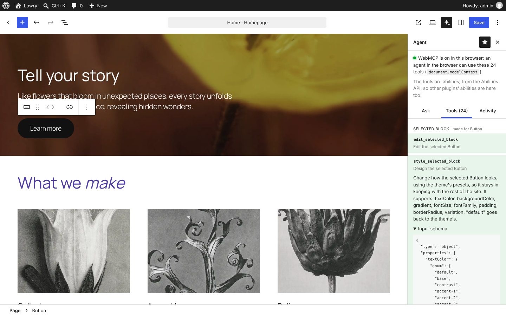
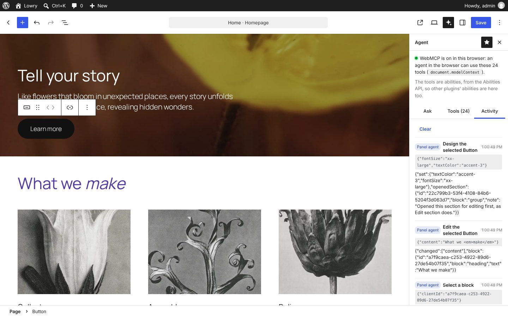

# Lowry: the site editor as WebMCP tools

A WordPress plugin that offers the site editor to agents through [WebMCP](https://github.com/webmachinelearning/webmcp), the proposed browser API that lets a page give an agent in the browser a set of tools. The agent doesn't scrape the page, click through it or rewrite the post's HTML on the server: it edits through the editor itself. So every change shows on the canvas as it happens, undo takes it back, the person can see and stop it, and nothing is saved until they save.

There's an **Agent** panel in the editor too. You can ask its agent for a change, see and run the tools on offer right now, and read a log of every call, whoever made it.

Requires WordPress 7.0 or later for the Abilities API (it works without it, with fewer tools). Developed and tested on WordPress 7.1 with Twenty Twenty-Five, in the site editor, and in Chromium 158 with WebMCP on and off.



## Why WebMCP for site editing

Most ways of letting an AI agent edit a WordPress site work on the server: an MCP server takes the post's content, changes it and saves it back. That leaves the person out of it until it's done, and it's easy to break blocks on the way.

WebMCP puts the tools in the page the person is already using, so the agent works in the same editor, on the same unsaved state, with the same undo. Lowry tries out what that makes possible:

- **Tools made for what's selected.** Select a block and the agent gets tools whose schemas are exactly that block: its own attributes, and its design made from what it supports and the theme's presets. Select another kind of block and they change (WebMCP's `toolchange`). "This" means what the person has selected.
- **The editor's own rules.** In WordPress 7, a section from a pattern takes new words and pictures straight away, and its design and structure only change once it's opened with **Edit section**. The tools work the same way: a content edit just happens, and a design change opens the section first, which the person sees.
- **Nothing is saved for you.** There's no save tool. Changes go into the editor's unsaved state, and the person reviews and saves them as they would their own.
- **Pointing, not just doing.** An agent can outline blocks on the canvas with a label, to show what it means or ask "this one?", without changing anything.
- **Every ability is a tool.** Lowry's tools are client-side abilities, from the Abilities API, and every ability on the page is offered to WebMCP: Lowry's, WordPress' own (`core/get-site-info` and so on) and any other plugin's.

## Try it

**[Try the live demo](https://automattic.github.io/site-editing-experiments/lowry/)**, or **[open it full screen in WordPress Playground](https://playground.wordpress.net/?blueprint-url=https://raw.githubusercontent.com/Automattic/site-editing-experiments/trunk/lowry/blueprint.json)**: a fresh, throwaway WordPress in your browser with Lowry active and the home page open in the site editor. Give it a minute to start, and use a desktop browser. Nothing is kept: closing or reloading the tab starts over.

On any site with Lowry active, `/wp-admin/?lowry-sample` makes the same sample page (four Twenty Twenty-Five patterns, as the home page) and opens it in the site editor.

There are three ways to use the tools:

- **With an agent in the browser.** Turn WebMCP on in Chrome (start it with `--enable-features=WebMCP`, or use its WebMCP flag in `chrome://flags`) and use an agent that speaks it, such as one of the [WebMCP extensions](https://chromewebstore.google.com/search/WebMCP). The panel says whether WebMCP is on.
- **With the panel's agent.** Open **Agent** (the sparkle at the top right), add an Anthropic API key, and ask. It's Claude, called from your browser with your key, which stays in your browser's local storage. That's fine for trying it on your own machine; a real version would go through the site's server.
- **By hand.** In **Tools**, open a tool, edit its input and **Run** it.

## The tools

| Tool | What it does |
| --- | --- |
| `get_editor_context` | What's open (the page or template), what's selected, unsaved changes, and whether undo is possible |
| `get_block_tree` | The page as an outline: each block's id, type and first words. Marks the template's blocks and sections whose layout is locked |
| `get_block` | One block in full: attributes, where it is, what it can turn into, its style variations and markup |
| `get_site_styles` | The theme's palette, font sizes, fonts and spacing sizes, and the site-wide styles set on top |
| `search_patterns` | The site's patterns, by words or category |
| `get_unsaved_changes` | What's changed since the last save |
| `point_at_blocks` | Outlines blocks on the canvas, with a label, without changing them |
| `select_block` | Selects a block, as a click does, which changes the selected-block tools |
| `update_block` | Sets some of a block's attributes |
| `insert_blocks` | Adds blocks, as `{ name, attributes, innerBlocks }` or block markup, before or after a block or at the start or end of one |
| `insert_pattern` | Adds a pattern |
| `remove_blocks`, `move_blocks`, `duplicate_block`, `transform_block` | What they say |
| `set_site_style` | Changes a site-wide style, like `elements.h2.typography.fontSize`, to CSS or a preset (`font-size:x-large`) |
| `set_palette_color` | Changes one of the theme's palette colours, everywhere it's used |
| `undo`, `redo` | Undo and redo, whoever made the change |

And for the selected block, made from its block type each time it changes:

| Tool | What it does |
| --- | --- |
| `edit_selected_block` | Its own attributes, typed from its `block.json`: a Heading's `content` and `level`, a Button's `text` and `url`, an Image's `alt` and `caption`… |
| `style_selected_block` | Its design, from what it `supports`, limited to the theme's presets: `textColor` is one of the palette's slugs, `fontSize` one of the theme's sizes, `padding` one of its spacing sizes. Also its style variations |
| `transform_selected_block` | What it can turn into, as a list to pick from |

An agent can't make up a colour for `style_selected_block`: the Abilities API checks input against the schema, and the error says what the palette has, so the agent can try again. Schemas never give a `default`, as agents and browsers fill defaults in, and a heading's `level` would be reset to 2 every time its words changed.



## The panel

- **Ask** sends what you ask to the agent with the tools on offer right now, runs the tools it calls, and repeats until it's done. The tool list is read afresh every turn, so once it selects a block it gets that block's tools. Each call shows as a line, green when it worked and red with the reason when it didn't; click one to show its blocks on the page. **Stop** stops it, and **New conversation** starts again.
- **Tools** lists every tool, grouped: Selected block, Read, Show, Change and WordPress (other abilities). Tools that just arrived are highlighted, so you can watch them change as you select blocks.
- **Activity** is every call, newest first, marked Panel agent, Browser agent or You, with its input and result, and **Show on the page** for any block it names.

When an agent in the browser changes something, a notice at the bottom of the editor says what.



## How it's built

- [`src/editor/tools/`](src/editor/tools/) are the tools. They read and change the editor through its data stores (`core/block-editor`, `core/editor` and `core-data`), as its own controls do.
- [`src/editor/schema.js`](src/editor/schema.js) makes the selected-block tools' schemas from a block type and the theme's presets, and turns a design tool's input into attributes as the editor's controls save them. It has unit tests.
- [`src/editor/host.js`](src/editor/host.js) registers the tools as client-side abilities, in a **Site editor** category, and offers every ability to WebMCP. The Abilities API's client is a script module, which a classic script can't import, so [`modules/abilities.js`](modules/abilities.js) imports it and hands it over. Without it, the tools go to WebMCP directly.
- [`src/editor/webmcp.js`](src/editor/webmcp.js) registers tools with `document.modelContext` (or `navigator.modelContext`) when the browser has it, each with an `AbortSignal` to take it away again, and keeps its own list for the panel. Every call goes through one function, which is how the activity log sees them all. Errors are returned as text: Chrome turns a thrown error into "Tool execution failed", and the agent couldn't learn from that.
- [`src/editor/agent.js`](src/editor/agent.js) is the panel's agent, and [`src/editor/highlight.js`](src/editor/highlight.js) draws the outlines on the canvas.

## What it doesn't do yet

- The panel's agent calls the API from the browser with your own key. A real one would go through the site's server, or use the WordPress AI Client, or Chrome's built-in model.
- Templates and template parts can be read but not changed while you edit a page. Open the template to change them, as you would.
- Every change is its own step of undo, so a request that took five changes takes five undos.
- WebMCP is still changing: Chrome moved it from `navigator.modelContext` to `document.modelContext` and made `executeTool` take an object. Lowry looks for both, but the next change may need another.
- The tools trust what's on the page. The read tools are marked as returning untrusted content, but a page that tells an agent to do something is still a risk.

## Running it

Build it once (the `build` folder is committed, so this is only needed after changes):

```
npm install
npm run build
```

Use npm 11 or later: npm 10 can't work out `@wordpress/scripts`' optional dependencies (`npx npm@11 install` works too).

### Tests

The schemas made from block types are in [`src/editor/schema.js`](src/editor/schema.js), with unit tests beside it:

```
npm run test:unit
```

The smoke test drives the real site editor in a headless Chromium with WebMCP on, and calls the tools the way an agent in the browser does, through `document.modelContext`. It checks that the tools are offered, with WordPress' own abilities; that selecting blocks changes the selected-block tools, with a `toolchange`; that a content edit doesn't open a locked section and a design change does; that a bad input says why; adding patterns and blocks, moving, duplicating, transforming, removing, site styles and palette colours, unsaved changes and undo; and that every block is still valid. Then it asks the panel's agent, with a scripted stand-in for the API, and checks it got the selected-block tools once it selected a block. It needs a WordPress site with Lowry active and automatic login, which WordPress Playground gives you:

```
npx @wp-playground/cli server --login --port=9400 \
  --mount=.:/wordpress/wp-content/plugins/lowry \
  --blueprint=e2e/blueprint.json
npm run test:e2e
```

Set `LOWRY_BASE_URL` to use another site, `LOWRY_SHOTS` to a folder to keep screenshots, `LOWRY_CHROME` to use a particular Chrome or Chromium, and `LOWRY_NO_WEBMCP` to run it without WebMCP.
