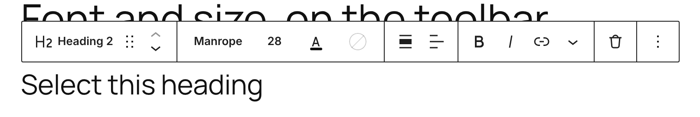
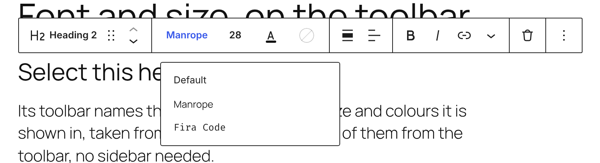
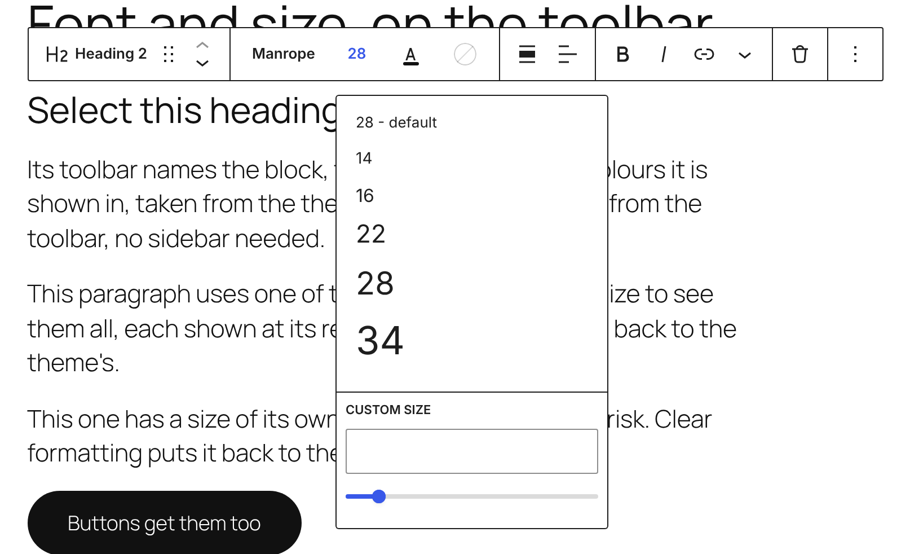
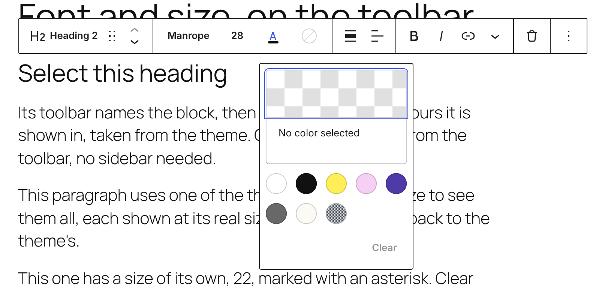
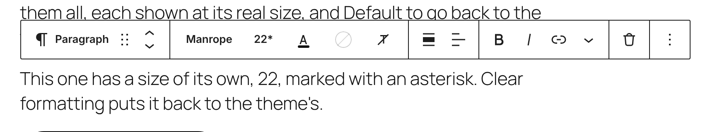
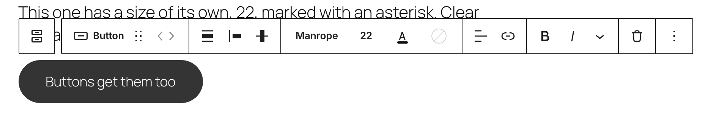
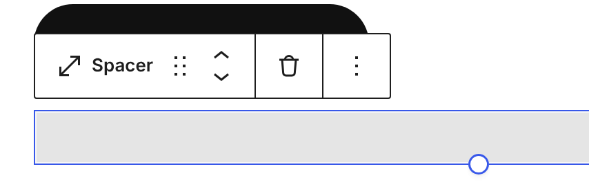
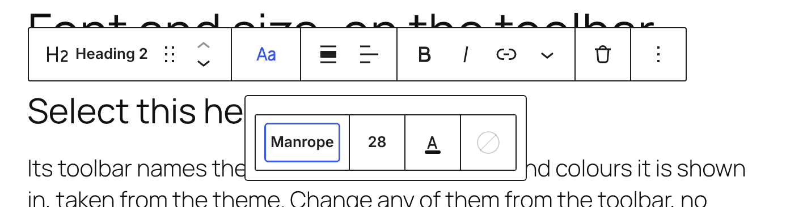

# Morris: font, size and colour in the block toolbar

Morris is a Gutenberg pull request rather than a static prototype: it puts a block's font, size and colours in its toolbar, behind an experiment, so it can be tried on real blocks and real themes. **[Gutenberg PR](https://github.com/WordPress/gutenberg/pull/86248)**

It's what's left of [Escher](../escher/) and [Hepworth](../hepworth/)'s writing toolbar once the Write / Design switch is gone. Everything that's on the toolbar today stays where it is. The type controls sit after the block's name and before the alignment controls, and a Delete button joins the end.

## Try it

**[Try the live demo](https://automattic.github.io/site-editing-experiments/morris/)**, or **[open it full screen in WordPress Playground](https://playground.wordpress.net/?blueprint-url=https://raw.githubusercontent.com/Automattic/site-editing-experiments/trunk/morris/blueprint.json)**: a fresh, throwaway WordPress in your browser with a build of the PR, the **Typography toolbar** experiment already on, and a sample post open with a heading, paragraphs, a button and a spacer. Give it a minute to start. Nothing is saved: closing or reloading the tab starts over.

Locally, check out the `scruffian/write-mode-toolbar-add` branch of Gutenberg, build it, and turn on **Typography toolbar** under Gutenberg → Experiments.

The build is `gutenberg.zip` in this folder, made from the PR at `a939f41`, because the PR's own builds expire after 14 days. When the PR changes, rebuild it: check out the branch, run `npm ci` and `NO_CHECKS=true npm run build:plugin-zip`, and replace `gutenberg.zip` with the result.

## What's in it

Selecting a block shows, in order:

- **Its name** beside its icon, "Heading 2" here. Until now only synced blocks, like patterns and template parts, were named.
- **Font** and **Size**, each naming what the block is shown in right now rather than a generic label. This heading follows the theme, so they say **Manrope** and **28**. That default comes from global styles, looking at the element (h2), then the block, then the site.
- **Text colour**, an A underlined in the colour the text is shown in, and **Background colour**, a swatch, empty when there's none.
- **Clear formatting**, only once the block has a font, size or colour of its own.
- The alignment and formatting tools as before, then **Delete**, so removing a block no longer means opening the options menu first.

### Font

The theme's font families, each shown in its own typeface, after **Default**, which clears the block's own choice. Picking one saves its slug to `fontFamily`. A font set some other way, outside the presets, is named by the first family in its stack.

### Size

The theme's sizes as numbers, each shown at its real size. The first item, **28 - default**, names the size the theme gives this block and clears the block's own choice. Below them, a number box and a slider set a size of your own, from 8 to 160.

### Colours

Text colour and Background colour each open the theme's palette. A palette colour saves its slug to `textColor` or `backgroundColor`, and any other colour saves to `style.color`.

### A size of your own, and clearing it

A size of your own is marked with an asterisk. Presets save to `fontSize` and sizes of your own to `style.typography.fontSize`, never both.

Once a block has a font, size or colour of its own, **Clear formatting** (a struck-through T) appears after the colours. It removes only what the toolbar sets, so the block goes back to what the theme gives it, and its spacing, borders and anything else stay as they were.

### Which blocks

Anything with a font, size or colour setting: headings, paragraphs, lists, quotes, buttons and so on. A block gets only the controls it supports.

Blocks without any of them, like the spacer, get none, but still get their name and Delete.

### On a narrower screen

Below 1080px, the type controls fold into one **Aa** button, which opens them in a toolbar of their own. The rest of the toolbar stays as it is.

### Keyboard

Alt+F10 moves to the toolbar, the arrow keys move between its tools, Enter opens a menu and Escape closes it, as for any other toolbar control.

## Open questions

- **Presets or anything?** Escher only offered the theme's presets, so every change stayed inside the design system. This offers a size and colours of your own too, as the sidebar does. Is that too easy a way out of the theme?
- **Changing it everywhere.** Hepworth asked whether a new colour should apply to every heading, button or section. Here a change is for this block only; changing it site-wide still means Styles.
- **What the theme gives.** The font, size and text colour name what the theme gives the block, but the background swatch doesn't: the button above has the theme's dark background and an empty swatch. And the custom size box is empty until you set a size, rather than showing the size in use.
- **Font weight, line height and letter spacing** stay in the sidebar.
- **Narrow screens.** Folding into Aa keeps the toolbar under 1080px, but it's still too wide for a phone.
