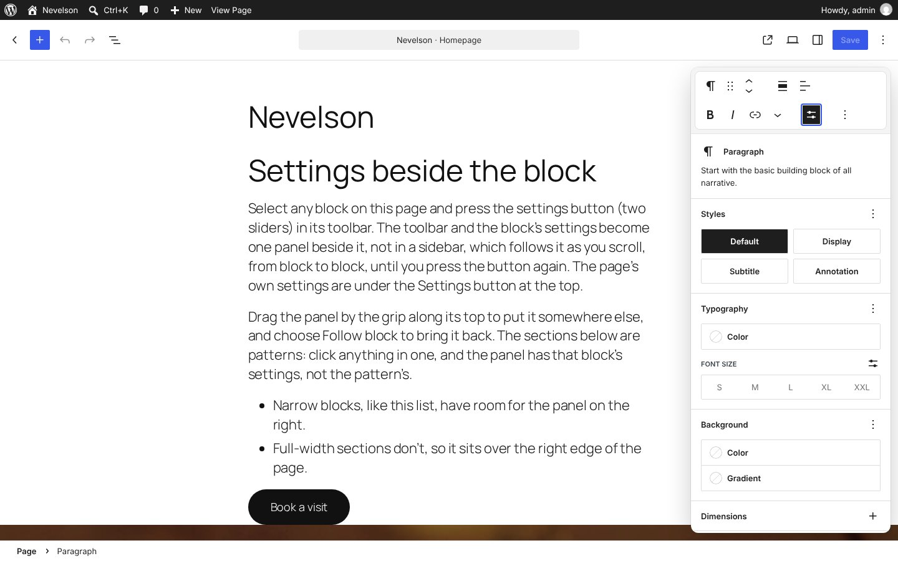
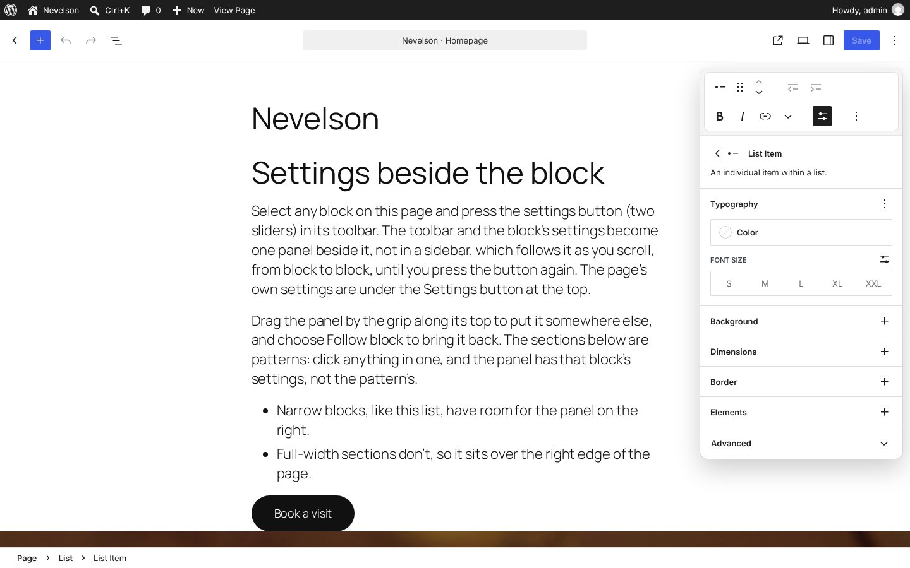

# Nevelson: the block's toolbar and settings in one floating panel

A WordPress plugin that tries out [Judd](../judd/)'s popovers in the real editor. In Judd, when you click something on the page, its settings open in a card beside it. Nevelson does something similar with the block toolbar and the block inspector: a settings button in the block's toolbar opens one floating panel, pinned to the right of the page, with the toolbar in a band along its top and the block's settings below. There's no sidebar: the page's own settings open in a card from the Settings button, as Judd's Edit page does.

It's the editor's own block inspector, moved, not a copy: every panel, tab and control is the same, including those added by other plugins.

Requires WordPress 7.0 or later (for sections). Developed and tested on WordPress 7.1 with Twenty Twenty-Five, in the post editor and the site editor.



## Try it

**This is an option, on its own branch: [open it in WordPress Playground](https://playground.wordpress.net/?blueprint-url=https://raw.githubusercontent.com/Automattic/site-editing-experiments/option/nevelson-pinned-panel/nevelson/blueprint.json)**, a fresh, throwaway WordPress in your browser with this version of Nevelson active and a sample page open in the editor. Give it a minute to start. Nothing is saved: closing or reloading the tab starts over. (The live demo and the trunk Playground link show the version on trunk, with the panel beside the block.)

The link runs [`blueprint.json`](blueprint.json), which installs the plugin straight from this branch; set its `ref` back to `trunk` if this is ever merged. On any site with Nevelson active, `/wp-admin/?nevelson-sample` makes the same sample page and opens it: a few blocks in the content width, then three full-width Twenty Twenty-Five patterns, each a section, as they are when inserted from the inserter.

## The floating panel

- **Selecting a block doesn't open anything.** The block's toolbar is above it as usual, with a **Block settings** button (two sliders) just before its options menu.
- **Press it, and the toolbar and the settings become one panel.** The toolbar moves into a band along the panel's top, a white bar of its own wrapping onto a second row to fit, and the block's settings are below. It's the block's own toolbar, every button and menu working as before. Press the button again to close the panel, and the toolbar goes back to the block. The panel stays open as you go from block to block, and isn't remembered: every visit starts with it closed.
- **Pinned to the right.** The panel is always in the same place, at the top right of the page, whatever block is selected and however wide it is, and it stays there as the page scrolls. It floats over the page, with a shadow, rather than taking its width from it as a sidebar would.
- **As tall as its controls.** A list item's panel is short; a paragraph's runs to the bottom of the screen and scrolls inside.
- **While you type**, the toolbar hides as it always does, and its band keeps its place. If the panel is over the text you're typing in, it fades until you stop.
- **In a pattern**, the toolbar's button for the parent block is hidden: the panel shows the parent above the block's name, and selects it.
- **Several blocks** selected share one panel.
- **Pop-ups** in the panel, such as colour pickers and the toolbar's menus, open over it.



## Always the block's own settings

In WordPress 7, blocks from a pattern or a template part are in a *section*. Click something in one and the editor selects the section, or shows the section's settings, until you choose to edit the section. That makes sense when a sidebar shows a section's settings, but not in a panel that has the clicked block's own toolbar.

So Nevelson always shows the settings of the block you clicked. Click a heading in a pattern and the panel is the heading's, toolbar and all: Nevelson opens the section for you, as Edit section would, and selects the heading. The panel shows which section it's in above the block's name, with core's **Exit pattern**.

While a section is open, core dims the rest of the page, and a click outside the section would only close it. Nevelson makes that click select what you clicked instead, opening its section if it's in one, so you can click from block to block across the page as if there were no sections.


## The page's settings

There's no sidebar. The **Settings** button opens the page's settings (or the template's, in the site editor) in a card just below it. There's no Block tab, because the block's settings are always in the panel, and the card stays on the page's settings when you select a block. The block's panel moves to the left of the card while it's open. A click on the page closes the card, as Judd's popovers close.

The editor opens with the card closed.


## On a narrow screen

When the canvas is narrower than 720px, there's no room for a panel at the side, so it's a sheet along the bottom, as in [Cassatt](../cassatt/), up to half the screen tall and scrolling inside. On a narrow screen the editor docks the block toolbar along the top, so there it stays, apart from the settings. Selecting a block under the sheet scrolls it up above it. Below 782px wide, WordPress shows the page's settings full screen, as usual.


## How it works

The toolbar is the editor's own: while the panel's open, Nevelson pins the toolbar's popover into the panel's band with CSS, over core's inline position, and lets it wrap to the panel's width. The panel is rendered in the editor's content area, which is a stacking context of its own, so the toolbar's popover can go over it.

The button is a `BlockControls` fill added to every block with the `editor.BlockEdit` filter, and whether the panel is open is in a small data store of Nevelson's own.

The plugin renders the editor's [`BlockInspector`](https://github.com/WordPress/gutenberg/tree/trunk/packages/block-editor/src/components/block-inspector) in a fixed card over the editor, through a portal from a registered plugin, so it's inside the editor's providers and every `InspectorControls` fill finds it. The sidebar's Block tab is hidden, and whenever the editor switches to it, Nevelson switches back to the page's tab, so there's only ever one inspector.

Each frame, it places the card with [`place.js`](src/editor/place.js) (small functions with unit tests), from the size of the canvas, which changes with the window and with the page's card, and writes the position straight to the card's style, so this doesn't re-render the inspector.

The page's card is the editor's own sidebar, restyled into a card and placed below the Settings button.

Opening sections is in [`sections.js`](src/editor/sections.js). After a click or a selection, if the selected block isn't the one clicked, or can't be edited as it is, Nevelson finds its section (its outermost ancestor that's a template part, a synced pattern, a block inserted from a pattern, or locked to its content), opens it with `__unstableSetTemporarilyEditingAsBlocks` (the public, deprecated name for opening a section) and selects the block. Blocks outside an open section don't take the pointer, so a click there is matched to a block by its box, and Nevelson keeps that click from the editor.

## Questions it raises

- Pinned to the right, the panel can cover the right of a full-width block. Should the page make room for it instead, as a sidebar would, while keeping it a floating card?
- Most blocks have so many settings that the panel runs to the bottom of the screen. Should it show only the most-used settings, with the rest a click away?
- Opening a section dims the rest of the page and adds Exit pattern. Is that still useful when every click goes to the block anyway, or should sections be invisible here?
- Keyboard: there's no shortcut yet to move between the block and its panel, and nothing announces the panel when it appears.

## Developing

```sh
npm install
npm run build        # or npm start to rebuild on change
npx vitest run       # where the panel goes
```

The end-to-end smoke test drives the real editor through all of the above in a headless browser, in the post editor, the site editor and on a narrow screen:

```sh
npx @wp-playground/cli server --login --port=9400 \
  --mount=.:/wordpress/wp-content/plugins/nevelson
npm run test:e2e     # NEVELSON_SHOTS=shots to keep screenshots
```

(Activate the plugin first, or start the server with a blueprint that does.)
