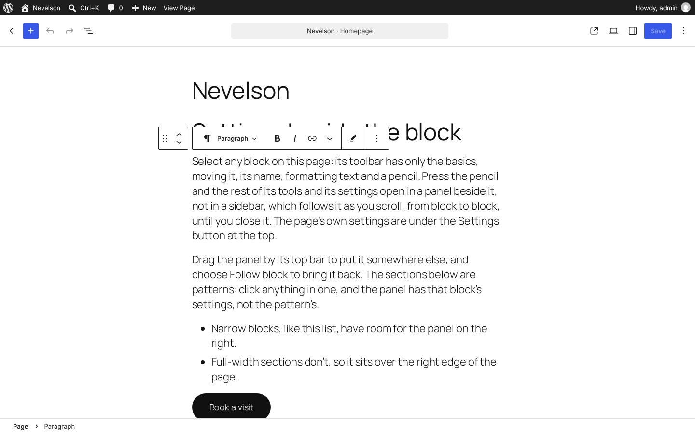
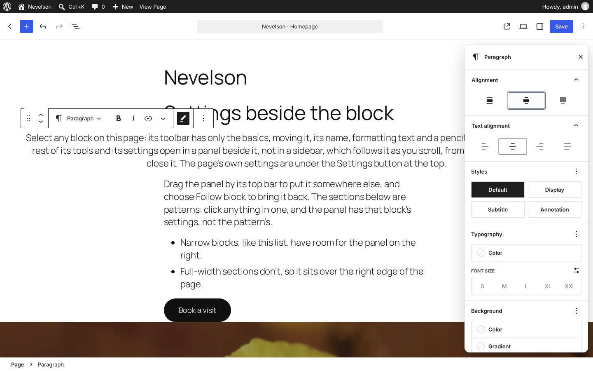
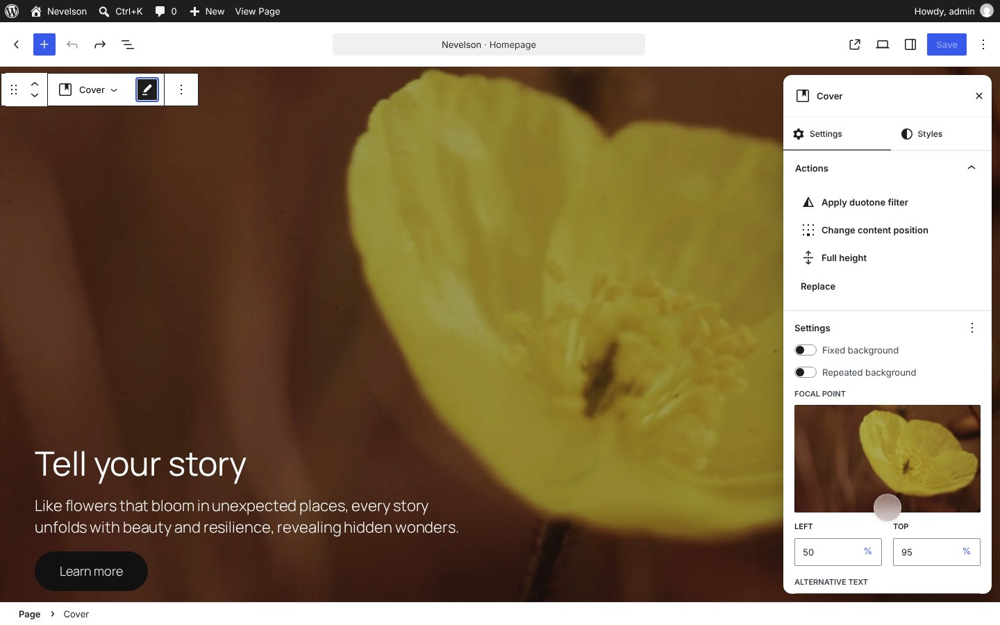
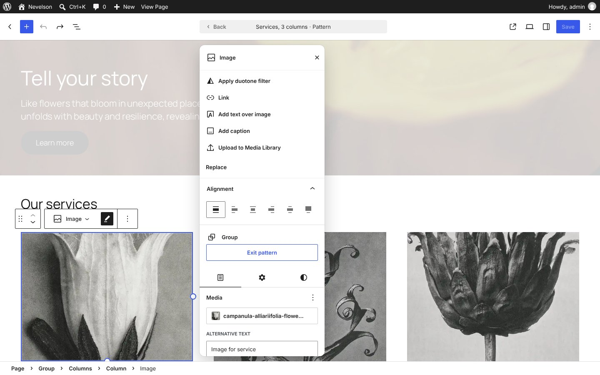
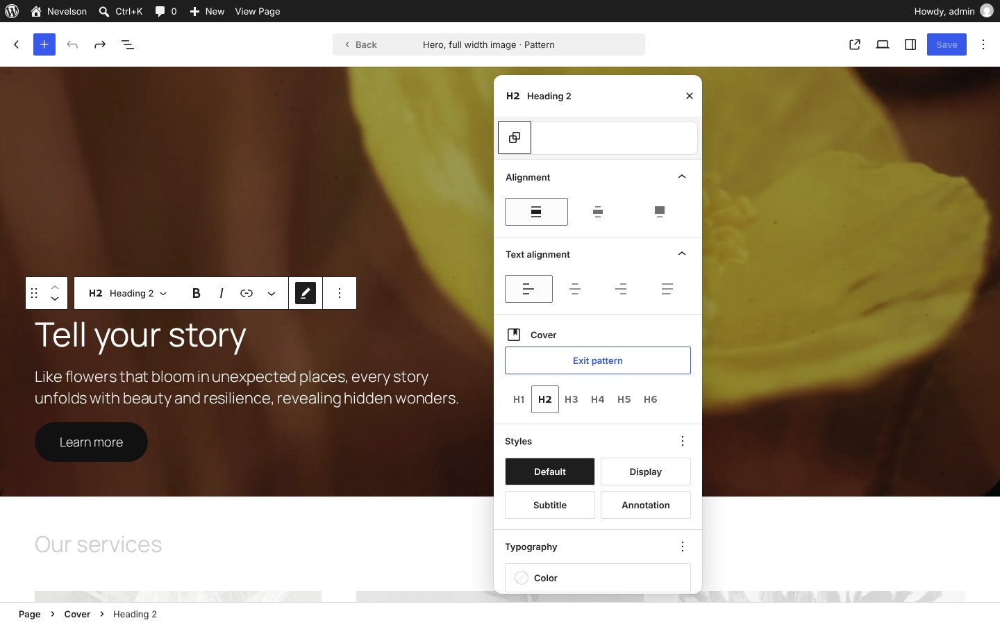
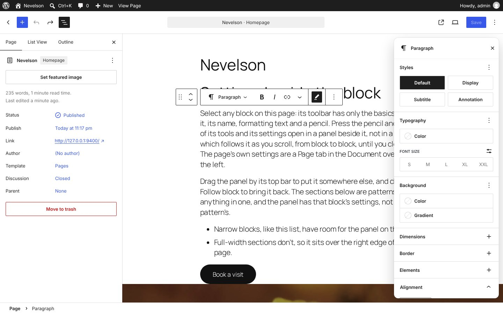
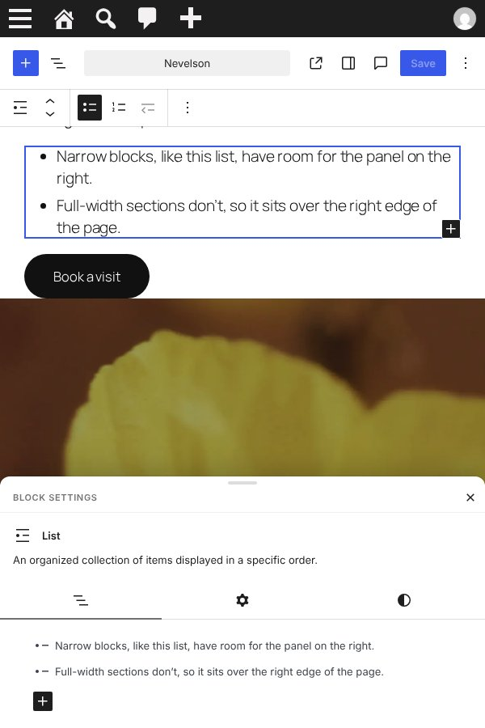

# Nevelson: block settings beside the block

A WordPress plugin that tries out [Judd](../judd/)'s popovers in the real editor. In Judd, when you click something on the page, its settings open in a card beside it. Nevelson does the same with the block's toolbar and inspector. By the block, the toolbar keeps only the basics: the drag handle and movers, the block's icon and name, formatting text, and a pencil. The pencil opens a floating panel next to the block, headed with the block's icon and name, with everything else: the toolbar's other tools along its top, alignment as panels, and the block's settings below. It follows the block as you scroll. There's no sidebar: the page's own settings open in a card from the Settings button, as Judd's Edit page does.

It's the editor's own block inspector, moved, not a copy: every panel, tab and control is the same, including those added by other plugins.

Requires WordPress 7.0 or later (for sections). Developed and tested on WordPress 7.1 with Twenty Twenty-Five, in the post editor and the site editor.





## Try it

**[Try the live demo](https://automattic.github.io/site-editing-experiments/nevelson/)**, or **[open it full screen in WordPress Playground](https://playground.wordpress.net/?blueprint-url=https://raw.githubusercontent.com/Automattic/site-editing-experiments/trunk/nevelson/blueprint.json)**: a fresh, throwaway WordPress in your browser with Nevelson active and a sample page open in the editor. Give it a minute to start. Nothing is saved: closing or reloading the tab starts over.

The link runs [`blueprint.json`](blueprint.json), which installs the plugin straight from this repo's `trunk`. On any site with Nevelson active, `/wp-admin/?nevelson-sample` makes the same sample page and opens it: a few blocks in the content width, then three full-width Twenty Twenty-Five patterns, each a section, as they are when inserted from the inserter.

## The floating panel

- **By the block, the toolbar has only the basics.** The **drag handle** (on the far left) and the **movers** sit just outside the block's left edge, apart from the toolbar; with no room there, as for a full-width block, they go back in the toolbar, at its far left. The toolbar has the **block's icon and name**, with a chevron: one button that opens the list of blocks to turn it into, below it (blocks that can't be turned into others, such as a pattern section, get the name without the chevron), **formatting text** (bold, italic, link and the formatting menu, for blocks with text) and a **pencil**. Everything else that's usually in the toolbar (alignment, the block's own tools such as Replace, and the options menu) is in the panel. The parent block's button is gone: it doesn't help, and the panel shows the parent block anyway.
- **The pencil opens the panel.** Its heading is the block's icon and name, with the block's description as its title text (hover over it), so the settings below don't repeat them. Below the heading, the tools that aren't in the block's toolbar are a list of settings, each with its icon and name: for an image, Apply duotone filter, Link, Add text over image, Add caption, Upload to Media Library and Replace. **Alignment** and **Text alignment** are panels of their own, every option showing at once, rather than toolbar dropdowns; they show where core's toolbar would offer them. The basics stay by the block while the panel's open. Close the panel with × or the pencil. It stays open as you go from block to block, and isn't remembered: every visit starts with it closed.
- **Beside the block:** on the right if there's room, on the left if not, and over the right edge of the page for full-width blocks. Its top is level with the block's (or its toolbar's), unless that would take it off the screen, so it moves up for a block low on the page and stays in view when the block scrolls away. It never covers the block's toolbar.
- **It follows the block** as the page scrolls, as you type, and as things above it change size. If it's over the text you're typing in, it fades until you stop.
- **Drag it** by its top bar to put it somewhere else. It stays there for every block, until **Follow block** puts it back beside the selected one.
- **Several blocks** selected share one panel.
- **Pop-ups** in the panel, such as colour pickers, open over it.





## Always the block's own settings

In WordPress 7, blocks from a pattern or a template part are in a *section*. Click something in one and the editor selects the section, or shows the section's settings, until you choose to edit the section. That makes sense with settings in a sidebar, but not with them beside the block you clicked.

So Nevelson always shows the settings of the block you clicked. Click a heading in a pattern and the panel is the heading's: Nevelson opens the section for you, as Edit section would, and selects the heading. The panel shows which section it's in, above the heading's settings, with core's **Exit pattern**.

While a section is open, core dims the rest of the page, and a click outside the section would only close it. Nevelson makes that click select what you clicked instead, opening its section if it's in one, so you can click from block to block across the page as if there were no sections.



## The page's settings

There's no sidebar. The **Settings** button opens the page's settings (or the template's, in the site editor) in a card just below it. There's no Block tab, because the block's settings are always in the panel, and the card stays on the page's settings when you select a block. The block's panel moves out of the card's way. A click on the page closes the card, as Judd's popovers close.

The editor opens with the card closed.



## On a narrow screen

When the canvas is narrower than 720px, there's no room beside anything, so the panel is a sheet along the bottom, as in [Cassatt](../cassatt/), up to half the screen tall and scrolling inside. Selecting a block under the sheet scrolls it up above it. Below 782px wide, WordPress shows the page's settings full screen, as usual.



## How it works

The pencil is a `BlockControls` fill added to every block with the `editor.BlockEdit` filter, and whether the panel is open is in a small data store of Nevelson's own. Core's toolbar groups have no names in the page, so Nevelson also adds a hidden marker to the formatting group, and puts the block's name (core's `BlockTitle`) and a chevron inside core's block switcher button, through a portal, passing clicks on them on to the button; by the block, CSS hides every group but the formatting group, the icon and movers' group, the pencil's and the options menu, and moves the movers out to the left. Core flips the switcher's list above the button when it's tall; Nevelson pins it below, scrolling inside. While the panel's open, the tools the toolbar doesn't show stay in core's toolbar, but Nevelson positions them, each frame, over the panel's band, one under another as wide as the panel, and gives each icon-only button its name (its `aria-label`) beside the icon; the panel is rendered in the editor's content area, a stacking context of its own, so the toolbar's popover can go over it. On a narrow screen, where the editor docks the toolbar at the top, they're shown there instead while the panel's open. The alignment panels are Nevelson's own ([`alignment.js`](src/editor/alignment.js)): they set the same `align` attribute and `typography.textAlign` style as core's dropdowns, and show only when core's toolbar has those dropdowns, which Nevelson then hides from the band. The heading uses core's `useBlockDisplayInformation`, and the block card in the settings is hidden, but for its parent's row in a section.

The plugin renders the editor's [`BlockInspector`](https://github.com/WordPress/gutenberg/tree/trunk/packages/block-editor/src/components/block-inspector) in a fixed card over the editor, through a portal from a registered plugin, so it's inside the editor's providers and every `InspectorControls` fill finds it. The sidebar's Block tab is hidden, and whenever the editor switches to it, Nevelson switches back to the page's tab, so there's only ever one inspector.

Each frame, it reads the selected blocks' boxes in the canvas iframe and places the card with [`place.js`](src/editor/place.js), a small function with unit tests. It writes the position straight to the card's style, so following the block doesn't re-render the inspector.

The page's card is the editor's own sidebar, restyled into a card and placed below the Settings button.

Opening sections is in [`sections.js`](src/editor/sections.js). After a click or a selection, if the selected block isn't the one clicked, or can't be edited as it is, Nevelson finds its section (its outermost ancestor that's a template part, a synced pattern, a block inserted from a pattern, or locked to its content), opens it with `__unstableSetTemporarilyEditingAsBlocks` (the public, deprecated name for opening a section) and selects the block. Blocks outside an open section don't take the pointer, so a click there is matched to a block by its box, and Nevelson keeps that click from the editor.

## Questions it raises

- Most blocks have so many settings that the panel is taller than the space beside them and rises above the block. Should the panel show only the most-used settings, with the rest a click away?
- Opening a section dims the rest of the page and adds Exit pattern. Is that still useful when every click goes to the block anyway, or should sections be invisible here?
- Is the Settings button the right home for the page's settings, or should they come from the document bar in the middle of the header, where the page's name is?
- Keyboard: there's no shortcut yet to move between the block and its panel, and nothing announces the panel when it appears.

## Developing

```sh
npm install
npm run build        # or npm start to rebuild on change
npx vitest run       # where the panel goes
```

The end-to-end smoke test drives the real editor through all of the above in a headless browser, in the post editor, the site editor and on a narrow screen:

```sh
npx @wp-playground/cli server --login --port=9400 \
  --mount=.:/wordpress/wp-content/plugins/nevelson
npm run test:e2e     # NEVELSON_SHOTS=shots to keep screenshots
```

(Activate the plugin first, or start the server with a blueprint that does.)
