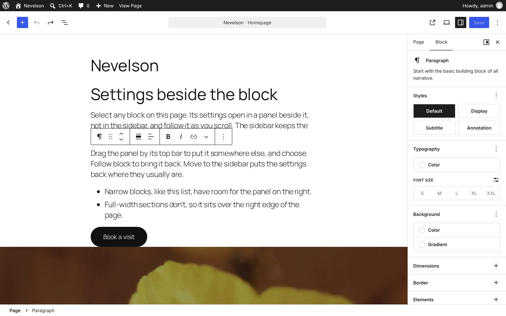

# Nevelson: block settings beside the block

A WordPress plugin that tries out [Judd](../judd/)'s popovers in the real editor. In Judd, the left panel holds the site, and when you click something on the page, its settings open in a card beside it. Nevelson does the same with the block inspector: select a block and its settings open in a floating panel next to it, not in the sidebar, and follow it as you scroll. The sidebar is left for the page's own settings.

It's the editor's own block inspector, moved, not a copy: every panel, tab and control is the same, including those added by other plugins.

Requires WordPress 6.8 or later. Developed and tested on WordPress 7.1 with Twenty Twenty-Five, in the post editor and the site editor.


## Try it

**[Try the live demo](https://automattic.github.io/site-editing-experiments/nevelson/)**, or **[open it full screen in WordPress Playground](https://playground.wordpress.net/?blueprint-url=https://raw.githubusercontent.com/Automattic/site-editing-experiments/trunk/nevelson/blueprint.json)**: a fresh, throwaway WordPress in your browser with Nevelson active and a sample page open in the editor. Give it a minute to start, and use a desktop browser. Nothing is saved: closing or reloading the tab starts over.

The link runs [`blueprint.json`](blueprint.json), which installs the plugin straight from this repo's `trunk`. On any site with Nevelson active, `/wp-admin/?nevelson-sample` makes the same sample page and opens it: a few blocks in the content width, then three full-width Twenty Twenty-Five sections.

## The floating panel

- **Select a block** and its settings open in a card beside it: on the right if there's room, on the left if not, and over the right edge of the page for full-width blocks. Its top is level with the block's, unless that would take it off the screen, so it moves up for a block low on the page and stays in view when the block scrolls away.
- **It follows the block** as the page scrolls, as you type, and as things above it change size. If it's over the text you're typing in, it fades until you stop.
- **Drag it** by its top bar to put it somewhere else. It stays there for every block, until **Follow block** puts it back beside the selected one.
- **Close** (×) hides it until you select another block.
- **Several blocks** selected share one panel, as they share the sidebar.
- **Pop-ups** in the panel, such as colour pickers, open over it as they do in the sidebar.


## The sidebar

The editor opens without its sidebar, to give the panel room beside the content; the Settings button opens it as usual. When it's open, it shows the page's settings (or the template's, in the site editor), and stays on them when you select a block, instead of switching to the Block tab. The page and the block each get a place of their own.

The block's settings can still go back in the sidebar:

- **Move to the sidebar** (the sidebar icon in the panel), or the sidebar's **Block** tab, puts them there, and the panel goes away.
- **Float** (the icon next to the sidebar's ×), the page's tab, or closing the sidebar floats them again.

With the sidebar open, the page is narrower, so there's often no room beside the content and the panel sits over the right edge of it.



## How it works

The plugin renders the editor's [`BlockInspector`](https://github.com/WordPress/gutenberg/tree/trunk/packages/block-editor/src/components/block-inspector) in a fixed card over the editor, through a portal from a registered plugin, so it's inside the editor's providers and every `InspectorControls` fill finds it. Only one inspector is ever on screen: the panel shows only when the sidebar isn't on its Block tab, and the sidebar unmounts the tab it isn't showing.

Each frame, it reads the selected blocks' boxes in the canvas iframe and places the card with [`place.js`](src/editor/place.js), a small function with unit tests. It writes the position straight to the card's style, so following the block doesn't re-render the inspector.

The sidebar staying on the page is the one place Nevelson works against the editor. Selecting a block switches an open sidebar to its Block tab, and so does opening the sidebar with a block selected. Nevelson watches the sidebar, and when it switches to the Block tab straight after a block was selected, or as it opens, switches it back. Choosing the Block tab yourself, from the page's tab, is left alone.

## Questions it raises

- Is beside the block the right place, or should it stay put in one corner, like a design tool's inspector? Dragging it there tests that.
- Full-width sections have no room beside them. Is over the edge good enough, or should it go below the toolbar, or collapse to a strip?
- Does having the page and the block in two places make it clearer what a setting applies to?
- Would people miss the sidebar for block settings once they've closed it?

## Developing

```sh
npm install
npm run build        # or npm start to rebuild on change
npx vitest run       # where the panel goes
```

The end-to-end smoke test drives the real editor through all of the above in a headless browser, in the post editor and the site editor:

```sh
npx @wp-playground/cli server --login --port=9400 \
  --mount=.:/wordpress/wp-content/plugins/nevelson
npm run test:e2e     # NEVELSON_SHOTS=shots to keep screenshots
```

(Activate the plugin first, or start the server with a blueprint that does.)
