# Quinn: reorder and hide pages in a Page List menu

Quinn is a Gutenberg pull request rather than a static prototype: it lets you reorder the pages in a Page List block inside a Navigation block, and switch pages on or off, without converting the menu to links. **[Gutenberg PR](https://github.com/WordPress/gutenberg/pull/86525)**

It's [O'Keeffe](../okeeffe/)'s prototype F, "All pages with menu switches", in the real editor. Every page is in one list, each with an "In menu" switch, and the menu follows the list's order. O'Keeffe's README noted that leaving a page out of an automatic menu "would need a new Page List setting that older WordPress would ignore". This is that setting.

## Try it

**[Try the live demo](https://automattic.github.io/site-editing-experiments/quinn/)**, or **[open it full screen in WordPress Playground](https://playground.wordpress.net/?blueprint-url=https://raw.githubusercontent.com/Automattic/site-editing-experiments/trunk/quinn/blueprint.json)**. Either one gives you a fresh, throwaway WordPress in your browser with a build of the PR, Twenty Twenty-Five, and Rosa's Bakery's pages. The site editor opens on the header, whose menu is a Page List. Give it a minute to start. Nothing is saved: closing or reloading the tab starts over.

Locally, check out the `add/page-list-reorder-and-hide-pages` branch of Gutenberg and build it. There's no experiment to turn on.

The build is `gutenberg.zip` in this folder, the PR's own build at `6393bd9`, kept here because the PR's builds expire after 14 days. When the PR changes, replace it: download `gutenberg.zip` from the PR's latest **Build Gutenberg Plugin Zip** run, or check out the branch and run `npm ci` and `NO_CHECKS=true npm run build:plugin-zip`.

## What's in it

### Pages, straight in the Navigation block

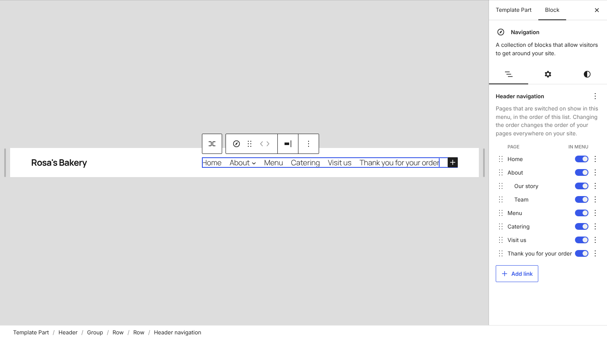

Click the menu in the header. Where the Navigation block's sidebar would list the Page List, it lists the pages themselves, with their child pages indented under them (Our story and Team, under About). Each row has:

- a **drag handle**: drag a page up or down among the pages at its level, and its child pages go with it. While you drag, a chip with the page's title follows the cursor, like the one shown when dragging blocks. Focus the handle and use the up and down arrow keys to do the same from the keyboard.
- an **In menu** switch: turn it off and the page leaves the menu. Pages that are off are still published, at their usual address.
- a **⋮ menu** with Move up, Move down and Add link after.

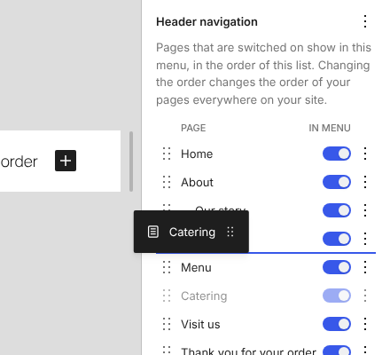

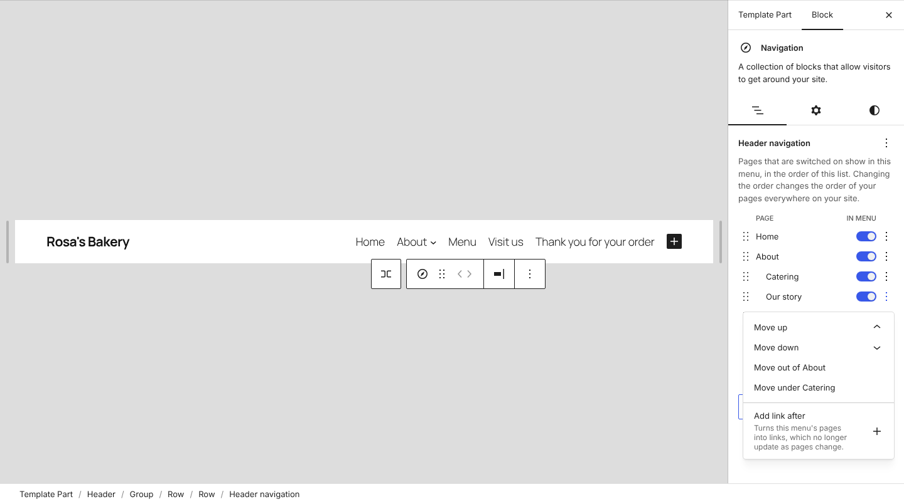

Neither the Page List nor its pages can be selected on their own: clicking one in the canvas selects the menu. The Page List never appears in the Navigation block's list of items, even when the menu has other links. Its Parent page setting and Detach button are out of reach inside a menu as a result, and Add link after does the detaching instead.

### On the Navigation screen

The site editor's **Navigation** screen, at Appearance > Editor > Navigation, shows a menu the same way: its pages, to switch on and off and reorder, then its other links. This works in the extensible site editor's Navigation screen too. Before this, a menu of only a Page List showed its pages as a list you could look at but not change.

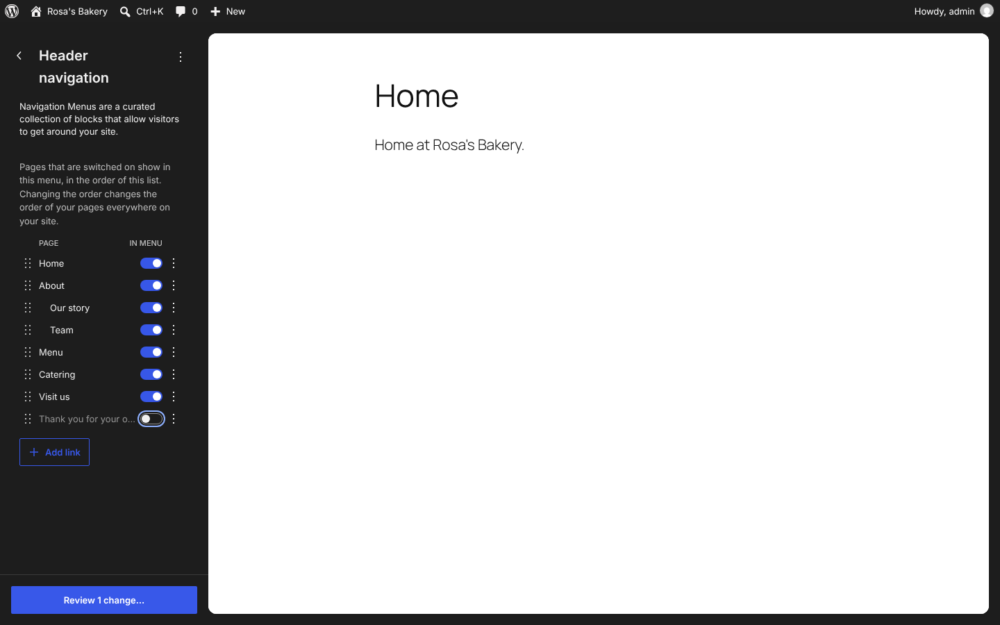

### Adding links

When the menu is only pages, an **Add link** button sits below them. It adds a link after the pages and opens its search. Once the menu has other links, the usual list of items appears below the pages, with only those links in it.

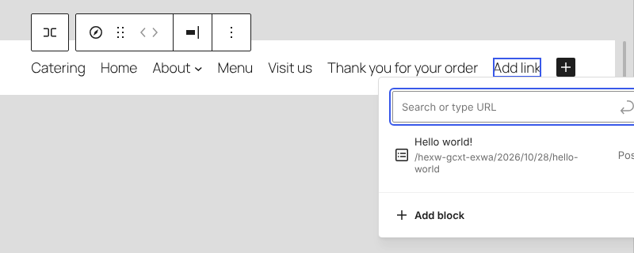

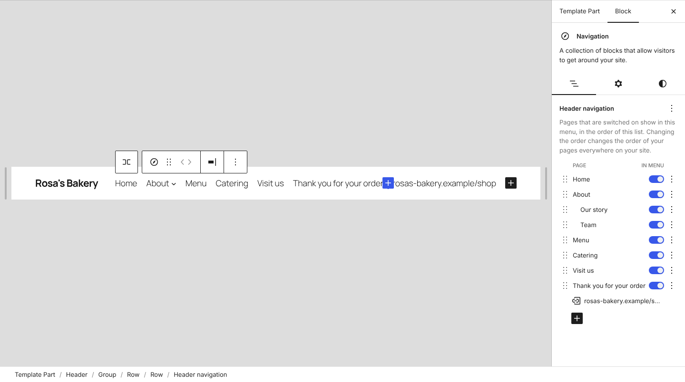

A link can't go between two pages of a Page List. So **Add link after** in a page's ⋮ menu turns the menu's pages into links first, as Detach does, then adds the new link after that page and opens its search. The ⋮ menu says so. From then on the menu is links, which no longer update as pages change.

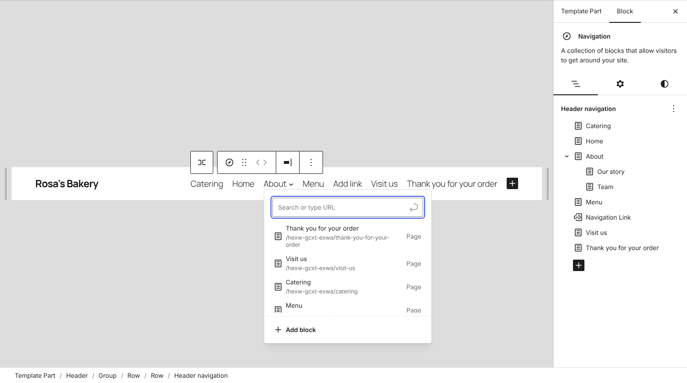

Dragging does the same, in the sidebar:

- drag another item of the menu, such as a custom or post link, from the list below the pages onto one of the pages, and it lands just before or after that page, at that page's level.
- drag a page by its handle onto the list of the menu's other items, and a line shows where it will land, before or after the item under it. Its child pages go with it.

Either way, the pages turn into links first, in the order shown and without hidden pages, and the menu becomes an ordinary menu of links. One Undo puts the Page List back.

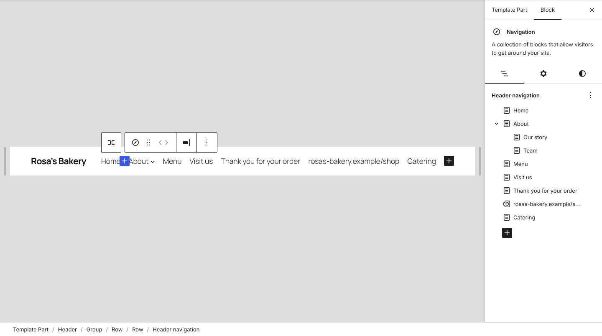

### Order is page order

Page List shows pages in page order (`menu_order`), so that's what the controls change. The menu stays automatic: a new page still appears in it, in its place. The pages you reorder appear in the save panel alongside the menu, and one Undo puts a whole move back.

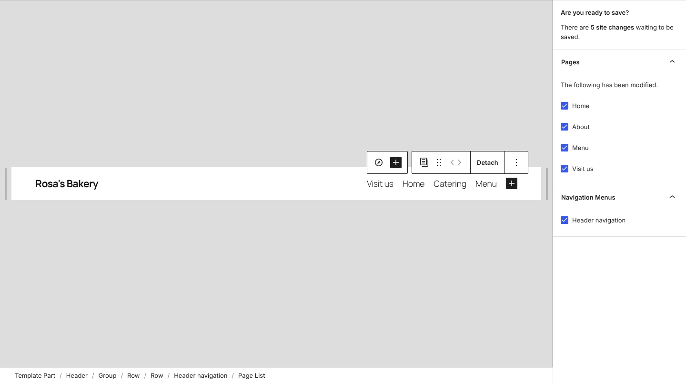

Because it's the site's page order, it changes every Page List on the site, and the help text says so. People who can't edit pages get the switches but no reorder controls.

### Hiding a page

A page that's switched off is saved on the block, in a new `excludedPageIDs` attribute, not on the page. The server leaves it out with `get_pages()` `exclude_tree`, so its child pages go too. In the list, a hidden page's child pages show their switches off and disabled. Switch the parent back on and they return as they were. Older WordPress ignores the attribute and shows every page.

Try it with **Thank you for your order**, which no one needs in a menu.

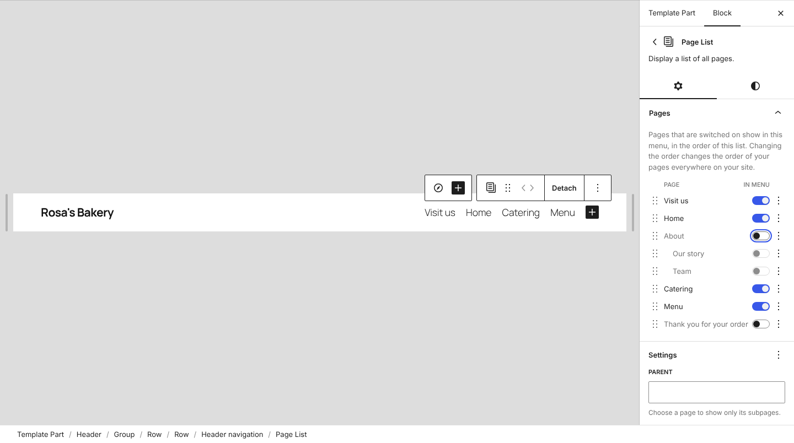

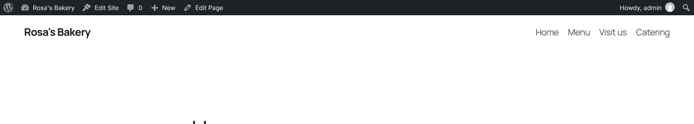

### Pages only through the Page List

While a Navigation block has a Page List, the Page List is the only way to add a page to that menu. Searching for a link elsewhere in the menu leaves pages out and suggests posts instead, as in the Add link screenshot above, and "Create page" isn't offered. Custom links, posts and categories can still be added.

### Detach

Detach, from a Page List's toolbar outside a menu, and Add link after both keep the menu you see: the same order, with hidden pages left out.

## Open questions

- **Site-wide order.** Reordering here changes the order of every Page List and of the Pages screen. That's the model F tested: the list *is* the menu. But someone moving Catering up in the header may not expect the footer's page list to change too. An order saved on the block would affect only this menu, at the cost of new pages needing a place in it.
- **Hidden parents.** Hiding a parent hides its child pages. F did the opposite: it promoted the child pages to the top level. Which matches what people expect?
- **Putting a page under another.** F's ⋮ menu also had "Put under About" and "Take out from under About", which change the page's parent and its address. This leaves those to the page's own settings.
- **Where the list lives.** The pages are in the Navigation block's sidebar. Would people also look for them on the Pages screen, as in O'Keeffe?
- **Dragging in the canvas.** Moving items in and out of the pages works in the sidebar. In the canvas, the pages can't be dragged, and other items can't be dropped among them.
- **Links between pages.** Add link after, and dragging a link among the pages, detach the whole menu to put one link between two pages. Is that a surprise, even with the note in the ⋮ menu? The alternative is a Page List that can hold links of its own.
- **Removing the pages.** With the Page List out of reach, the only way to take every page out of a menu is to switch each one off. Does it need a "Remove pages" action, or the Parent page setting, in the menu's sidebar?
- **The canvas's + button.** The menu's + in the canvas adds a Page Link, labelled "Select page", which here can't link to a page. In a menu with a Page List it should probably add a custom link, as the sidebar's Add link button does.
- **Many pages.** The panel lists every page, up to the 100 that Page List loads in the editor. A site with hundreds would need search or collapsed sections.
