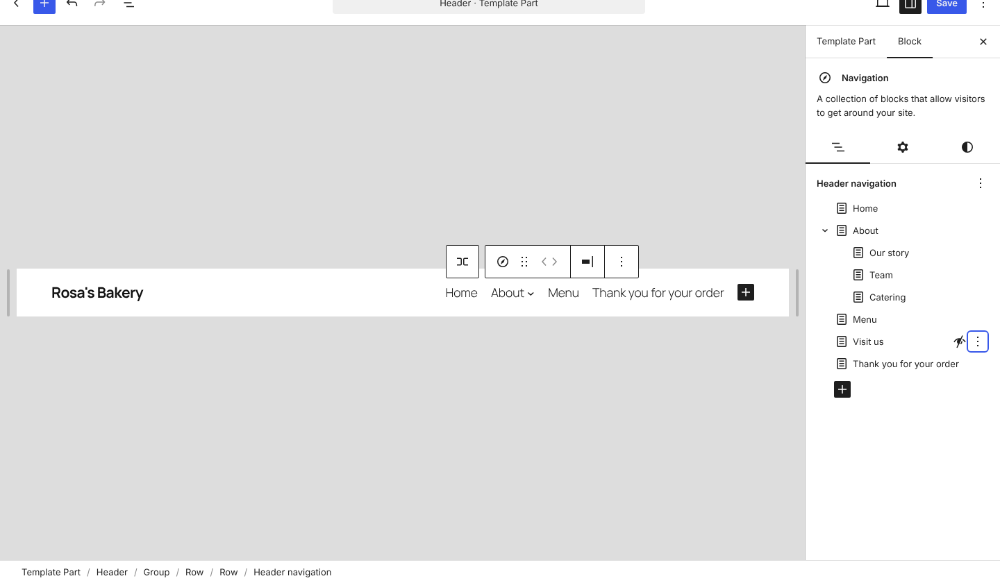
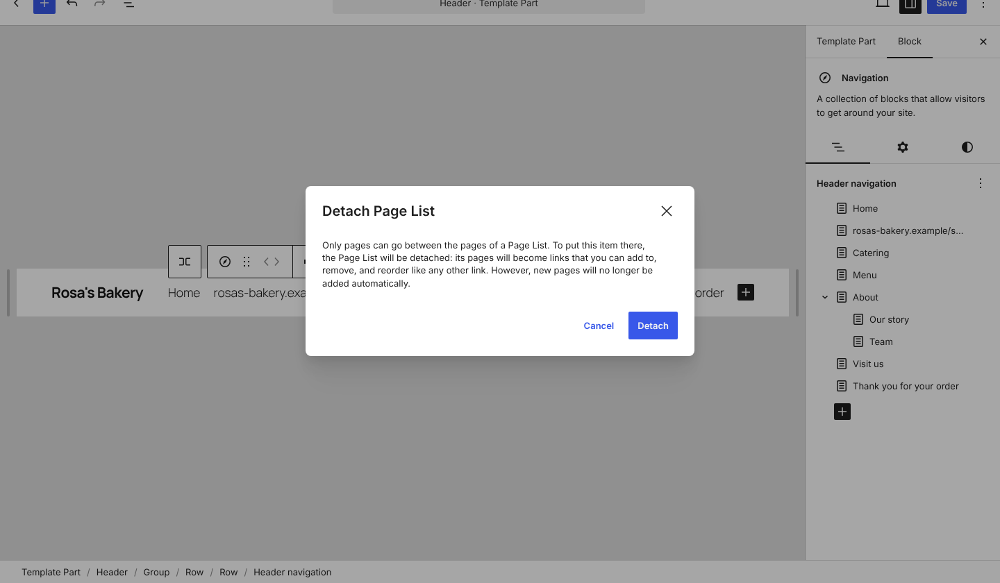
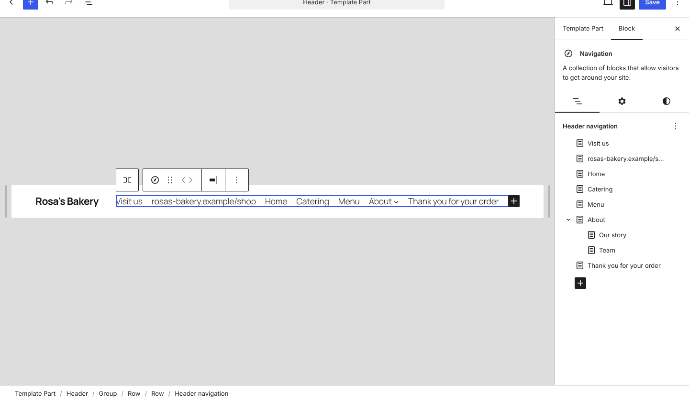

# Quinn: reorder and hide pages in a Page List menu

Quinn is a Gutenberg pull request rather than a static prototype: it lets you reorder the pages in a Page List block inside a Navigation block, and hide pages, without converting the menu to links. **[Gutenberg PR](https://github.com/WordPress/gutenberg/pull/86525)**

It started as [O'Keeffe](../okeeffe/)'s prototype F, "All pages with menu switches", in the real editor. After review, the separate list of pages with switches gave way to the Navigation block's own list of items: the pages are listed, moved and hidden exactly like links, so a menu works one way whatever is in it.

## Try it

**[Try the live demo](https://automattic.github.io/site-editing-experiments/quinn/)**, or **[open it full screen in WordPress Playground](https://playground.wordpress.net/?blueprint-url=https://raw.githubusercontent.com/Automattic/site-editing-experiments/trunk/quinn/blueprint.json)**. Either one gives you a fresh, throwaway WordPress in your browser with a build of the PR, Twenty Twenty-Five, and Rosa's Bakery's pages. The site editor opens on the header, whose menu is a Page List. Give it a minute to start. Nothing is saved: closing or reloading the tab starts over.

Locally, check out the `add/page-list-reorder-and-hide-pages` branch of Gutenberg and build it. There's no experiment to turn on.

The build is `gutenberg.zip` in this folder, the PR's own build at `a8e847e`, kept here because the PR's builds expire after 14 days. When the PR changes, replace it: download `gutenberg.zip` from the PR's latest **Build Gutenberg Plugin Zip** run, or check out the branch and run `npm ci` and `NO_CHECKS=true npm run build:plugin-zip`.

## What's in it

### Pages are menu items

Click the menu in the header. The Navigation block's sidebar lists the pages as its items, with child pages under their parent. There's no Page List row to get past: the list view leaves the Page List out and shows its pages in its place.

The pages work like any other item:

- **Drag** a page to move it, with its child pages. Drag it in or out of another page to change its level, as with a submenu.
- The **⋮ menu** has Move up, Move down, Add before, Add after, and Hide.
- In the canvas, a page can be selected like a link.

Moving a page changes the site's page order (`menu_order`), and moving it in or out of another page changes its parent, and so its address. The pages you move appear in the save panel alongside the menu, and one Undo puts a move back. People who can't edit pages can't move them.

### Hiding a page

**Hide** in a page's ⋮ menu is the same Hide that links now have: the item gets the hidden icon and leaves the menu. **Show** brings it back. A hidden page is saved on the block, in a new `excludedPageIDs` attribute, and the server leaves it out with its child pages. Removing a page, with Delete, hides it instead, as a Page List lists every page. Older WordPress ignores the attribute and shows every page.

Try it with **Thank you for your order**, which no one needs in a menu.

### Links and pages together

A Page List can only hold pages. So putting a link between two pages, by dragging it there or with Add before or Add after on a page, asks to detach the Page List first. Dragging a page out among the menu's other links asks the same. The dialog says what you did and what follows: the pages become ordinary links, and new pages won't be added automatically. **Cancel** puts things back as they were. **Detach** turns the pages into links in the order shown, keeping hidden pages as hidden links.

A link dropped before or after all the pages doesn't need that: it goes next to the Page List. A page dropped right next to the Page List goes back in, as its first or last page.

### On the Navigation screen

The site editor's **Navigation** screen, at Appearance > Editor > Navigation, lists the pages the same way, with the same dragging and Hide. So does the extensible site editor's Navigation screen.

### Pages only through the Page List

While a Navigation block has a Page List, the Page List is the only way to add a page to that menu. Searching for a link elsewhere in the menu leaves pages out and suggests posts instead, and "Create page" isn't offered. Custom links, posts and categories can still be added.

## Open questions

- **Site-wide order.** Reordering here changes the order of every Page List and of the Pages screen. Someone moving Catering up in the header may not expect the footer's page list to change too. An order saved on the block would affect only this menu, at the cost of new pages needing a place in it.
- **Hidden parents.** Hiding a parent hides its child pages, which the list view shows as they were. F promoted the child pages to the top level instead.
- **Changing a page's address.** Moving a page in or out of another page changes its address, and nothing warns about that.
- **Links between pages.** Putting one link between two pages still detaches the whole menu. The dialog now asks first, but the alternative is a Page List that can hold links of its own.
- **Reaching the Page List.** With its row gone from the list view, its Parent page setting and Detach button are reached from a page's sidebar, with Select Page List. Is that findable enough?
- **The canvas's + button.** The menu's + in the canvas adds a Page Link, labelled "Select page", which here can't link to a page. In a menu with a Page List it should probably add a custom link.
- **Many pages.** The list shows every page, up to the 100 that Page List loads in the editor.
