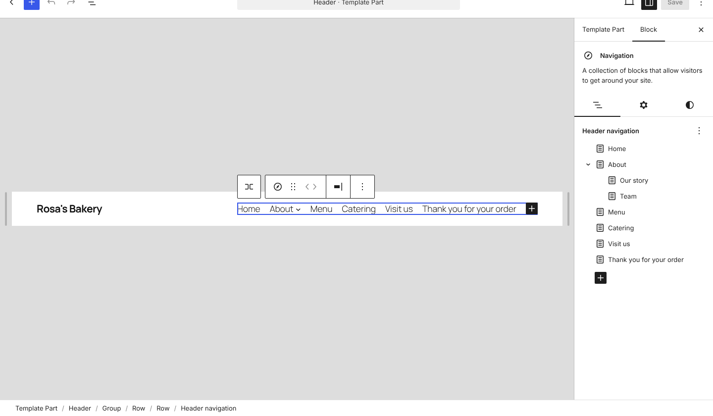
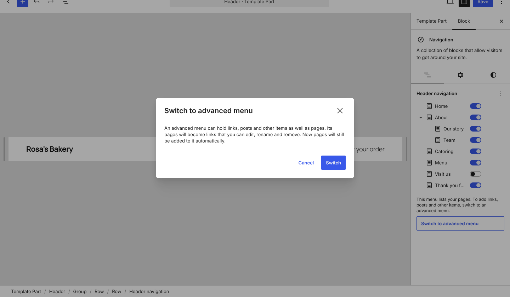
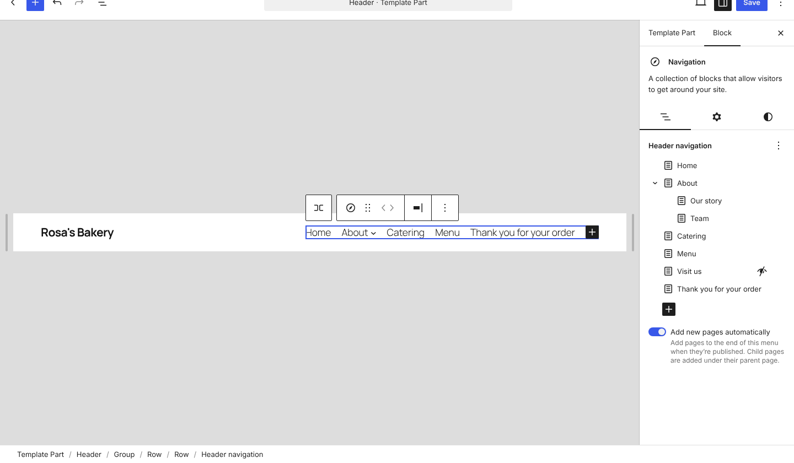
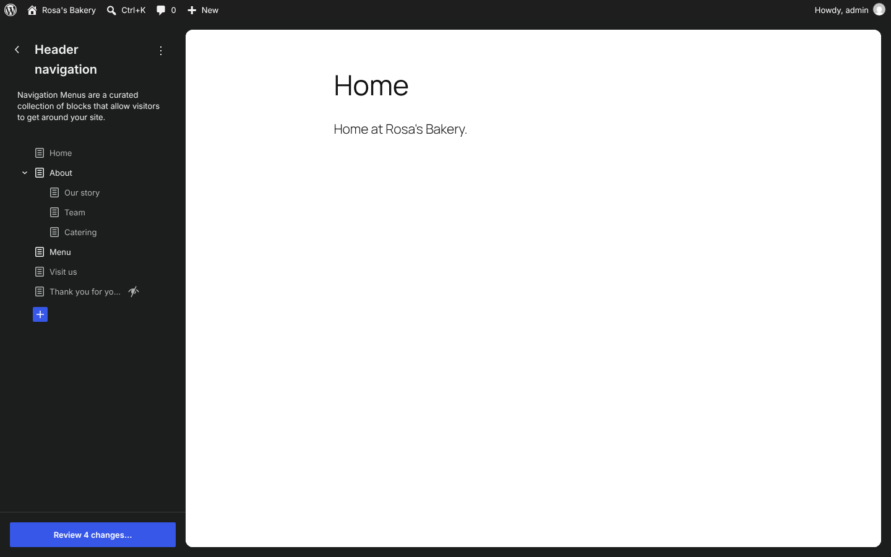

# Quinn: reorder and hide pages in a Page List menu

Quinn is a Gutenberg pull request rather than a static prototype: it lets you reorder the pages in a Page List block inside a Navigation block, and hide pages, without converting the menu to links. **[Gutenberg PR](https://github.com/WordPress/gutenberg/pull/86525)**

It started as [O'Keeffe](../okeeffe/)'s prototype F, "All pages with menu switches", in the real editor. After review, the pages moved into the Navigation block's own list of items, so they're moved like links. A menu of pages lists only pages, each with a show/hide toggle, and switching to an advanced menu turns them into links that can sit alongside anything else, while new pages are still added.

## Try it

**[Try the live demo](https://automattic.github.io/site-editing-experiments/quinn/)**, or **[open it full screen in WordPress Playground](https://playground.wordpress.net/?blueprint-url=https://raw.githubusercontent.com/Automattic/site-editing-experiments/trunk/quinn/blueprint.json)**. Either one gives you a fresh, throwaway WordPress in your browser with a build of the PR, Twenty Twenty-Five, and Rosa's Bakery's pages. The site editor opens on the header, whose menu is a Page List. Give it a minute to start. Nothing is saved: closing or reloading the tab starts over.

Locally, check out the `add/page-list-reorder-and-hide-pages` branch of Gutenberg and build it. There's no experiment to turn on.

The build is `gutenberg.zip` in this folder, the PR's own build at `0fb29a9`, kept here because the PR's builds expire after 14 days. When the PR changes, replace it: download `gutenberg.zip` from the PR's latest **Build Gutenberg Plugin Zip** run, or check out the branch and run `npm ci` and `NO_CHECKS=true npm run build:plugin-zip`.

## What's in it

### A pages menu

Click the menu in the header. A menu whose only item is a Page List is a **pages menu**: the Navigation block's sidebar lists the pages as its items, with child pages under their parent, and no Page List row to get past.

- **Drag** a page to move it, with its child pages, or in and out of another page to change its level. The ⋮ menu has Move up and Move down.
- **Toggle** a page off to take it out of the menu, and on to bring it back. Pages that are off are still published, at their usual address.

That's all a pages menu does: nothing else can be added to it, in the sidebar or the canvas, and its pages can't be removed. Moving a page changes the site's page order (`menu_order`), and moving it in or out of another page changes its parent, and so its address. The pages you move appear in the save panel alongside the menu, and one Undo puts a move back. People who can't edit pages can't move them.

A page that's off is saved on the block, in a new `excludedPageIDs` attribute, and the server leaves it out with its child pages. Older WordPress ignores the attribute and shows every page. Try it with **Thank you for your order**, which no one needs in a menu.

### Switching to an advanced menu

To add links, posts or anything else, choose **Switch to advanced menu** below the pages. After a confirmation, the pages become ordinary links, in the order shown and at their levels, with pages that were off kept as hidden links. The menu can then hold anything, and its links are edited, hidden and removed like any links.

An advanced menu still gets new pages. Switching turns on its new **Add new pages automatically** setting: when a page is published, a link to it is added at the end of the menu, or at the end of its parent page's submenu if the parent page is in the menu. The setting is saved on the menu (`auto_add_pages`), and can be turned off below the list.

Menus that already have a Page List and other links keep working as before: their pages are moved and toggled the same way, and putting a link between pages, or a page among the links, asks to detach first.

### On the Navigation screen

The site editor's **Navigation** screen, at Appearance > Editor > Navigation, lists a pages menu the same way, with the same toggles and Switch to advanced menu. So does the extensible site editor's Navigation screen.

### Pages only through the Page List

While a Navigation block has a Page List, the Page List is the only way to add a page to that menu. Searching for a link elsewhere in the menu leaves pages out and suggests posts instead, and "Create page" isn't offered. Custom links, posts and categories can still be added.

## Open questions

- **Site-wide order.** Reordering here changes the order of every Page List and of the Pages screen. Someone moving Catering up in the header may not expect the footer's page list to change too.
- **Toggles, then the eye.** In a pages menu a page is switched off with a toggle. After switching to an advanced menu, it's a link hidden with the eye icon and Hide, like any link. Should advanced menus get toggles too?
- **Hidden parents.** Switching a parent off hides its child pages too, though their toggles stay on.
- **Changing a page's address.** Moving a page in or out of another page changes its address, and nothing warns about that.
- **Auto-added pages.** New pages are added when they're first published, at the end of the menu. Is the end the right place? And a page whose parent page isn't in the menu isn't added at all.
- **Reaching the Page List.** With its row gone, its Parent page setting and Detach are reached from a page's sidebar, with Select Page List.
- **Many pages.** The list shows every page, up to the 100 that Page List loads in the editor.
