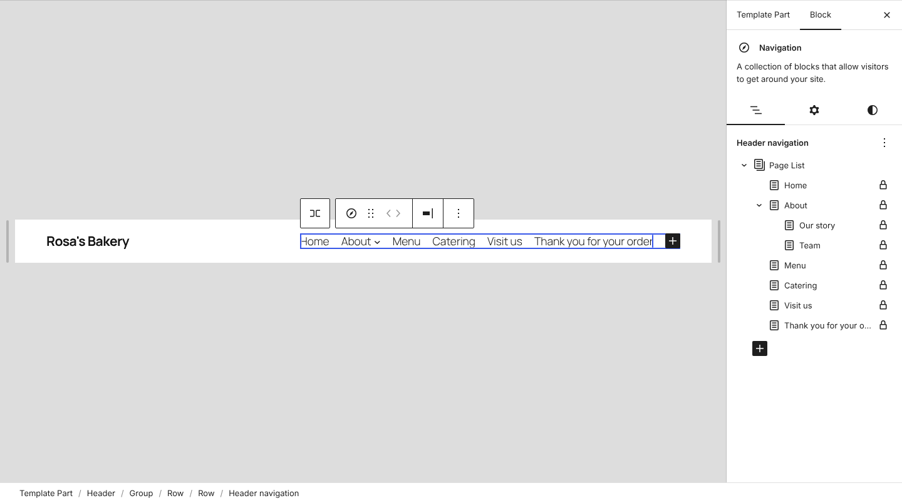
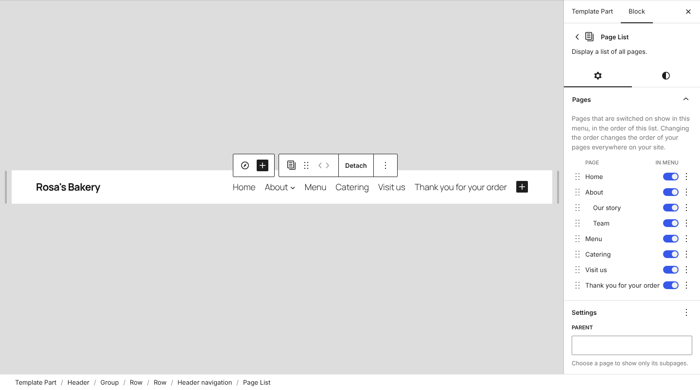
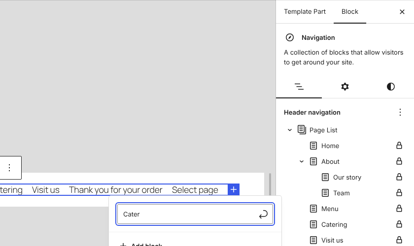

# Quinn: reorder and hide pages in a Page List menu

Quinn is a Gutenberg pull request rather than a static prototype: it lets you reorder the pages in a Page List block inside a Navigation block, and switch pages on or off, without converting the menu to links. **[Gutenberg PR](https://github.com/WordPress/gutenberg/pull/86525)**

It's [O'Keeffe](../okeeffe/)'s prototype F, "All pages with menu switches", in the real editor. Every page is in one list, each with an "In menu" switch, and the menu follows the list's order. O'Keeffe's README noted that leaving a page out of an automatic menu "would need a new Page List setting that older WordPress would ignore". This is that setting.

## Try it

**[Try the live demo](https://automattic.github.io/site-editing-experiments/quinn/)**, or **[open it full screen in WordPress Playground](https://playground.wordpress.net/?blueprint-url=https://raw.githubusercontent.com/Automattic/site-editing-experiments/trunk/quinn/blueprint.json)**. Either one gives you a fresh, throwaway WordPress in your browser with a build of the PR, Twenty Twenty-Five, and Rosa's Bakery's pages. The site editor opens on the header, whose menu is a Page List. Give it a minute to start. Nothing is saved: closing or reloading the tab starts over.

Locally, check out the `add/page-list-reorder-and-hide-pages` branch of Gutenberg and build it. There's no experiment to turn on.

The build is `gutenberg.zip` in this folder, the PR's own build at `b38609e`, kept here because the PR's builds expire after 14 days. When the PR changes, replace it: download `gutenberg.zip` from the PR's latest **Build Gutenberg Plugin Zip** run, or check out the branch and run `npm ci` and `NO_CHECKS=true npm run build:plugin-zip`.

## What's in it

### The Pages panel

Click the menu in the header, then **Page List** in the sidebar's list of the menu's items. The Page List's settings open with a **Pages** panel at the top. Every page is listed with its child pages indented under it (Our story and Team, under About). Each row has:

- a **drag handle**: drag a page up or down among the pages at its level, and its child pages go with it. Focus the handle and use the up and down arrow keys to do the same from the keyboard.
- an **In menu** switch: turn it off and the page leaves the menu. Pages that are off are still published, at their usual address.
- a **⋮ menu** with Move up and Move down.

In the menu's list, each page now has a lock icon, since its place is set in this panel and it can't be dragged out of the Page List. Clicking a page no longer opens a dialog asking whether to detach the Page List. Detach is still in the toolbar and in Settings, for menus that need custom links or a different order from the site's.

### Order is page order

Page List shows pages in page order (`menu_order`), so that's what the panel changes. The menu stays automatic: a new page still appears in it, in its place. The pages you reorder appear in the save panel alongside the menu, and one Undo puts a whole move back. 

Because it's the site's page order, it changes every Page List on the site, and the panel's help text says so. People who can't edit pages get the switches but no reorder controls.

### Hiding a page

A page that's switched off is saved on the block, in a new `excludedPageIDs` attribute, not on the page. The server leaves it out with `get_pages()` `exclude_tree`, so its child pages go too. In the panel, a hidden page's child pages show their switches off and disabled. Switch the parent back on and they return as they were. Older WordPress ignores the attribute and shows every page.

Try it with **Thank you for your order**, which no one needs in a menu.

### Pages only through the Page List

While a Navigation block has a Page List, the Page List is the only way to add a page to that menu. Searching for a link elsewhere in the menu leaves pages out and suggests posts instead, and "Create page" isn't offered. Custom links, posts and categories can still be added. Page items can't be dragged out of the Page List into the Navigation either.

### Detach

Detach now keeps the menu you see: the same order, with hidden pages left out.

## Open questions

- **Site-wide order.** Reordering here changes the order of every Page List and of the Pages screen. That's the model F tested: the list *is* the menu. But someone moving Catering up in the header may not expect the footer's page list to change too. An order saved on the block would affect only this menu, at the cost of new pages needing a place in it.
- **Hidden parents.** Hiding a parent hides its child pages. F did the opposite: it promoted the child pages to the top level. Which matches what people expect?
- **Putting a page under another.** F's ⋮ menu also had "Put under About" and "Take out from under About", which change the page's parent and its address. This leaves those to the page's own settings.
- **Where the list lives.** The panel is in the Page List's sidebar. Would people look for it in the Navigation block's list view, or on the Pages screen, as in O'Keeffe?
- **The menu's + button.** It adds a Page Link, labelled "Select page", which here can't link to a page. In a menu with a Page List it should probably add a custom link.
- **Many pages.** The panel lists every page, up to the 100 that Page List loads in the editor. A site with hundreds would need search or collapsed sections.
