# Squarespace-style site editor

A WordPress plugin that makes the site editor look and work like the Squarespace editor. Unlike the other experiments in this repo it isn't a static mockup: it runs inside a real site editor, on real blocks, and everything it does is saved as ordinary block markup and global styles.

Requires WordPress 6.8 or later and a block theme. Developed against WordPress 7.1 with Twenty Twenty-Five, and the end-to-end tests also pass with Twenty Twenty-Four.

## Tour

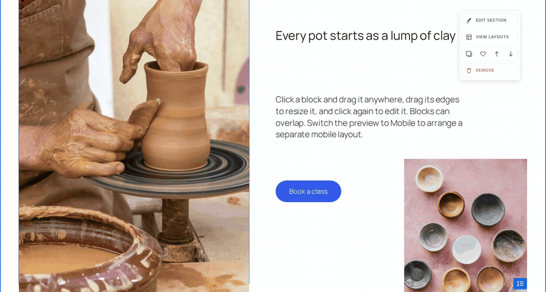

| | |
| --- | --- |
| 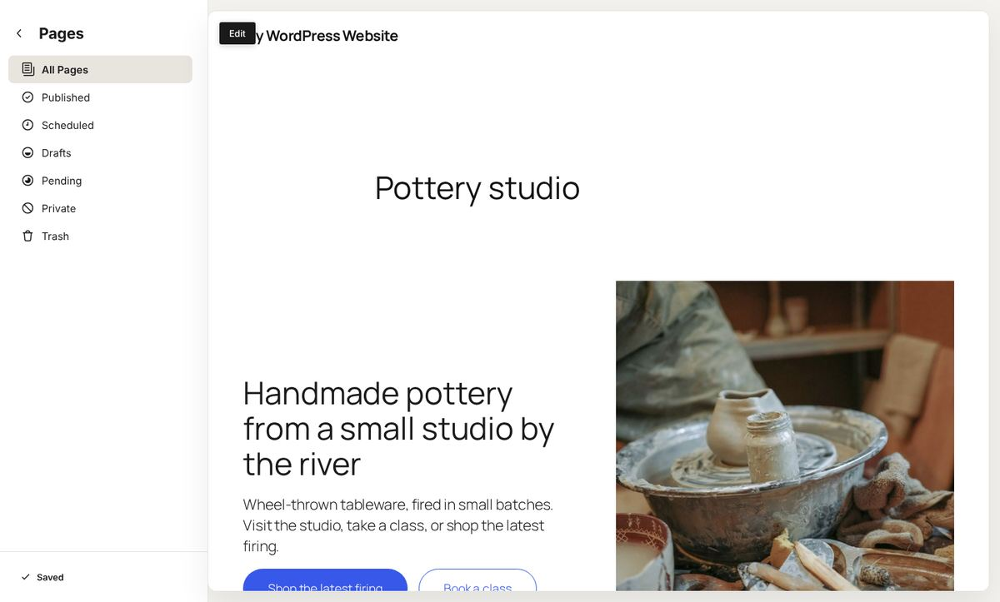 | 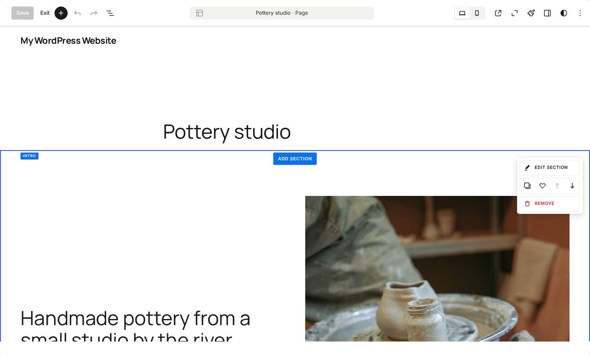 |
| **Browse mode.** The page in its template, header and all, with an Edit button. | **A section.** Hover shows its type, Add section and the section menu. |
| 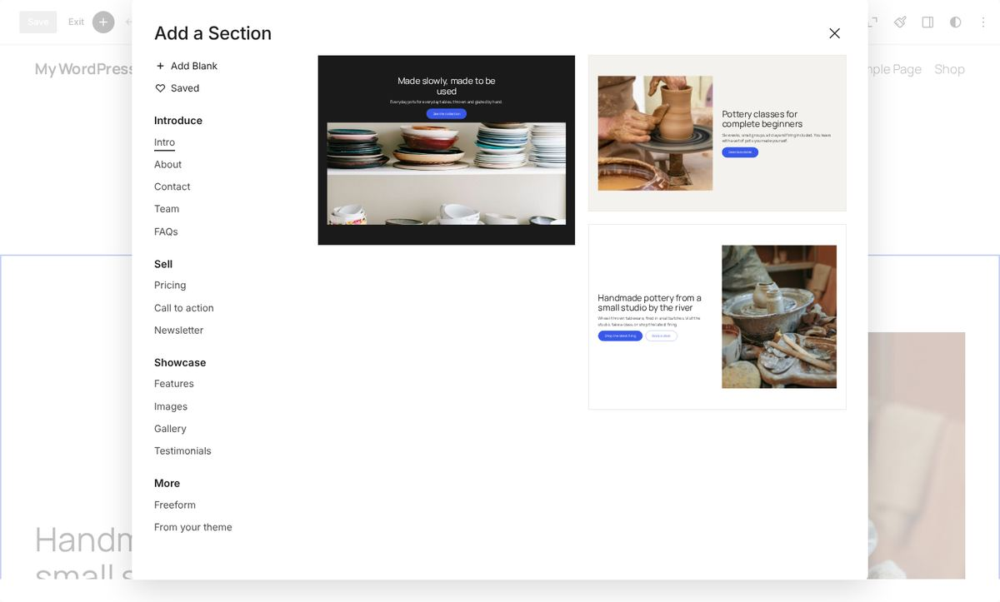 | 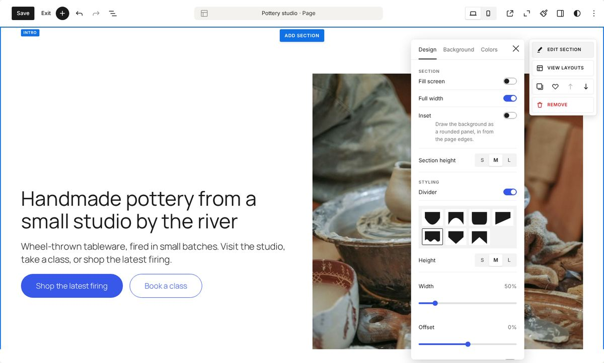 |
| **Add a Section.** Blank, saved sections and grouped layouts. | **Edit section → Design.** Size, inset, dividers (shape, height, width, offset, stroke) and anchor. |
| 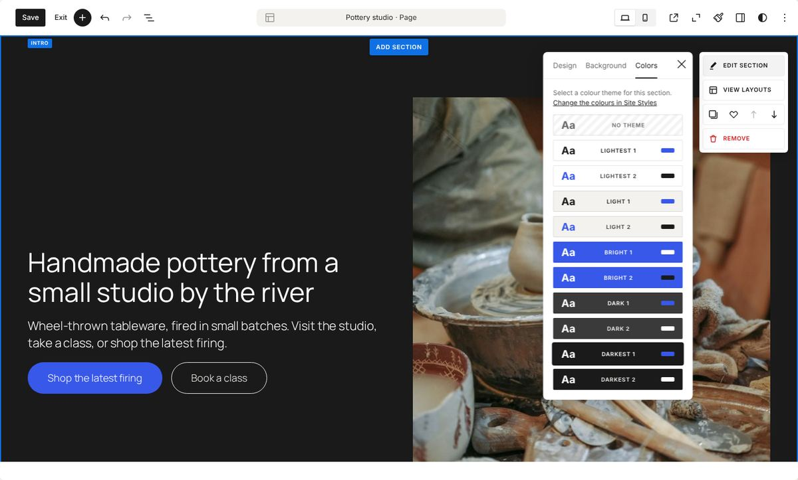 | 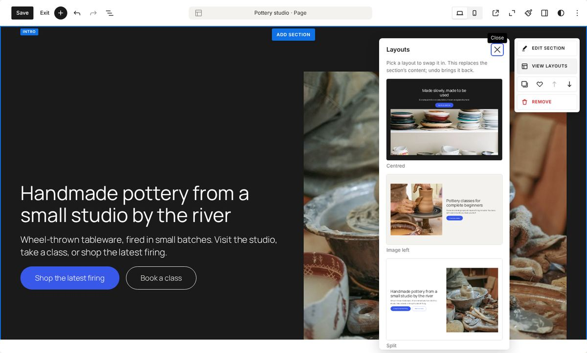 |
| **Edit section → Colors.** Ten colour themes drawn from the palette. | **View layouts.** Swap the layout and keep the content's colours. |
| 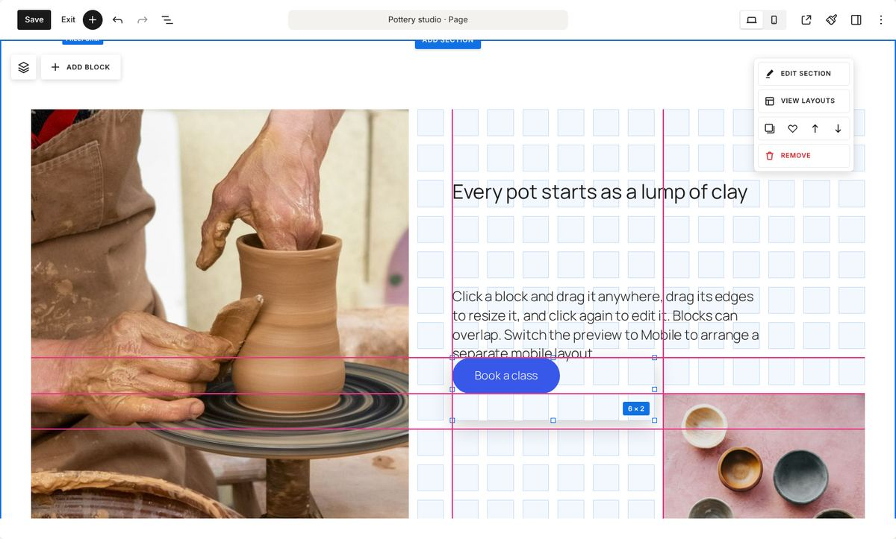 | 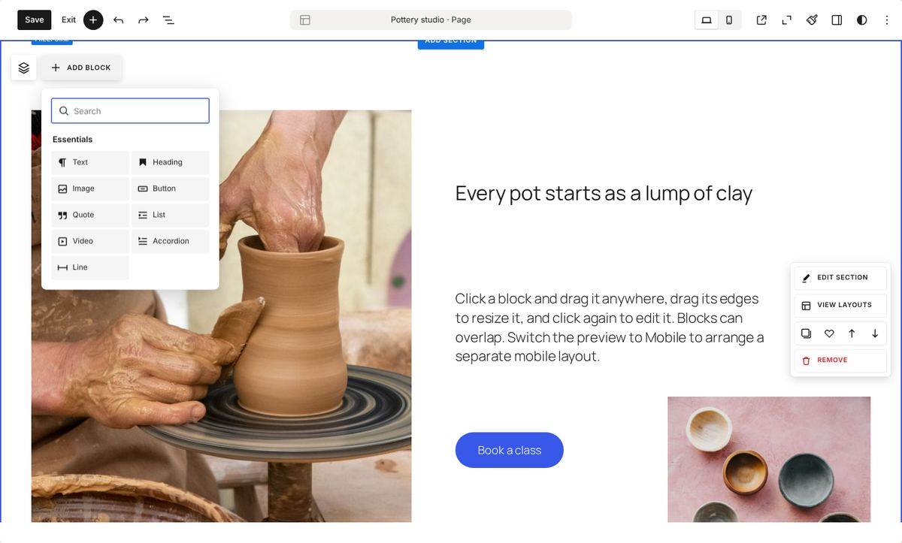 |
| **Freeform.** The grid and guides show while you drag. | **Add Block.** The essentials, placed on the grid. |
| 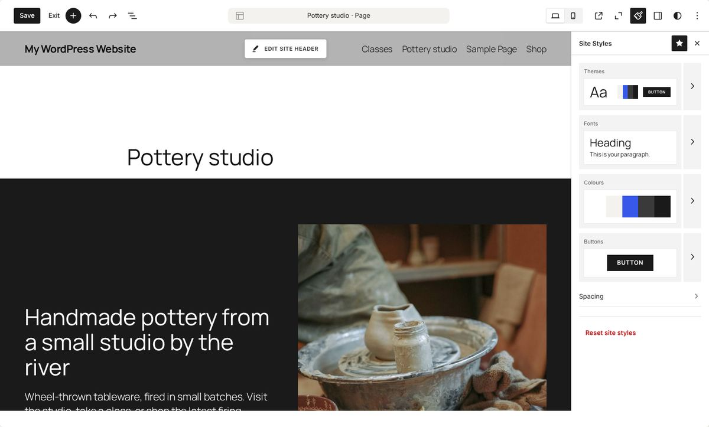 | 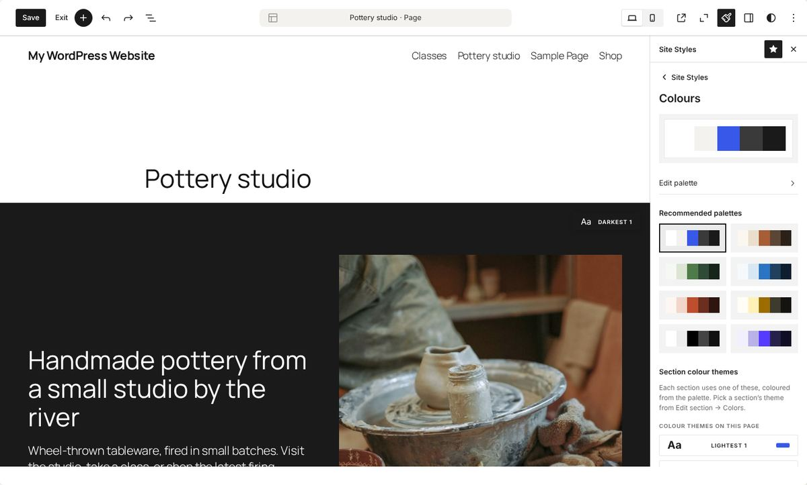 |
| **Site Styles.** Themes, fonts, colours, buttons and spacing. | **Colours.** One palette feeds every section's theme. |
| 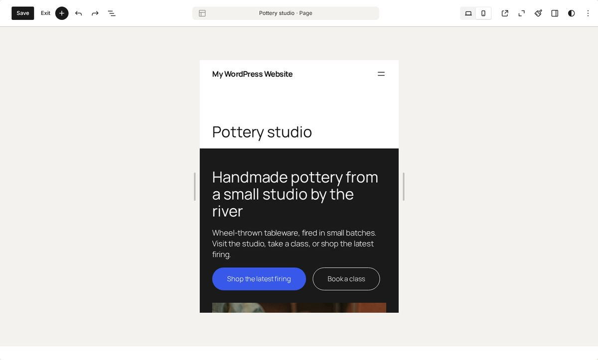 | 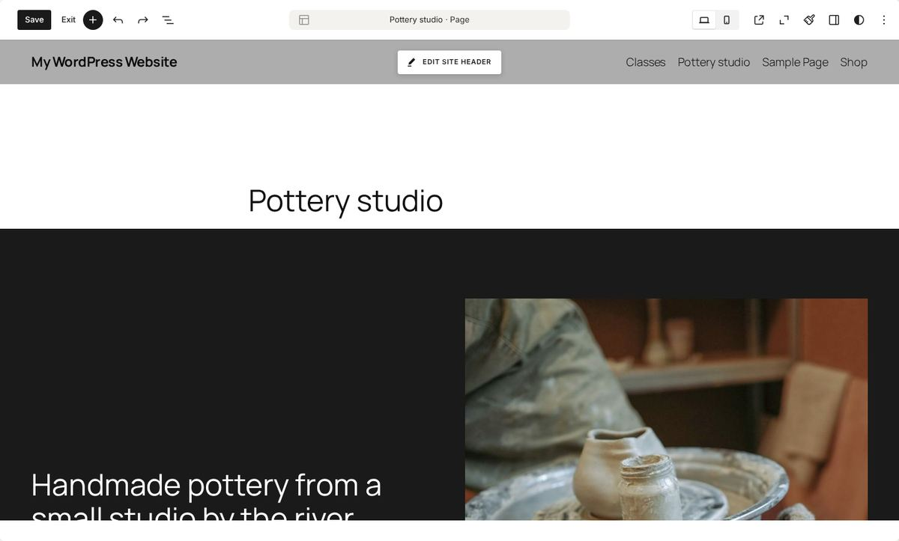 |
| **Mobile.** Freeform sections get their own mobile layout. | **Site header.** Shown around every page, with Edit site header on hover. |
| 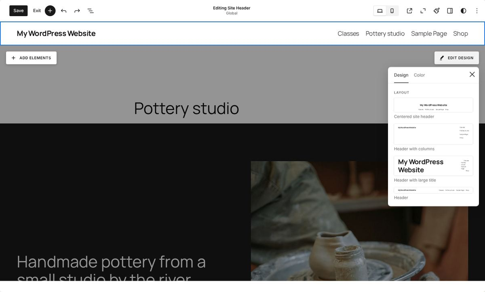 | |
| **Editing the header.** The page dims; Add elements and Edit design (layouts and colours). | |

## What it does

The details follow Squarespace's editor (version 7.1, checked in October 2026): its section menu, Add a Section picker, Edit section panel, Fluid Engine and Site Styles.

### Editor chrome

- **Browse mode** shows the site in a white Website/Pages panel, with an **Edit** button on the preview.
- **Pages open inside their template**, so the site header and footer show around the page, as they do in Squarespace, and can be edited from there. (WordPress would otherwise show a page's content on its own. Turning "Show template" off from the editor's menu sticks, and the `sse_show_page_template` filter turns the default off.) Placeholders the template brings with it (an empty featured image, a logo or tagline that hasn't been set) are hidden while they're locked, since nothing shows on the site either; editing the header or footer brings them back.
- **Edit mode** starts canvas first, with the settings sidebar closed. **Save** and **Exit** sit at the left of the top bar (Save stays grey until there's something to save), the page title is in the middle, and a desktop/mobile switch is on the right. Save and Exit use core's own save and back buttons, so saving works exactly as before.

### Sections

Every top-level block on a page (or every block in Post Content, when the template is shown) is a section:

- **Hover a section** to outline it in blue, with a small tag on its top edge naming its type (INTRO, FEATURES…) and a menu at its top right: **Edit section**, **View layouts**, a row of duplicate, save, move up and move down, and a red **Remove**. Remove shows a snackbar with **Undo**. In a tall section the menu stays in view as you scroll.
- **Add section** buttons sit in the middle of the hovered section's top and bottom edges. An empty page shows one **Add section** button.
- **Header and footer** read **Header · shown on every page** and **Footer · shown on every page**, offer **Edit site header**/**Edit site footer**, and can't be moved, duplicated or removed. Editing one dims the rest of the page and shows **Add elements** and **Edit design** (layouts and colours); changes save to the header or footer itself, so every page gets them.

#### Add a Section

The picker has **Add Blank** (an empty freeform section) and **Saved** (sections saved with the heart) at the top, then section types under headings: **Introduce** (Intro, About, Contact, Team, FAQs), **Sell** (Pricing, Call to action, Newsletter), **Showcase** (Features, Images, Gallery, Testimonials) and **More** (Freeform, and the theme's own patterns). Previews fill two columns at their natural height. Every section type has two or three layouts, 30 in all.

Inserted sections are named after their type, so their tag reads "Intro" rather than "Group".

#### Edit section

A panel beside the section's menu with three tabs:

- **Design:** row count and gap (freeform sections), Fill screen, Full width, Inset (the background as a rounded panel in from the page edges), Section height (S, M, L), a **Divider** (seven shapes for the section's bottom edge, three heights, a width that repeats the shape when narrow or stretches it when wide, a sideways offset, flip, and a thin or thick stroke along the edge in the section's link colour) and an anchor link name.
- **Background:** **Image** (add, replace or remove a background image), **Video** (a looping background video under an overlay in the section's own colour, with an Overlay slider) or **Art**: six gradient backgrounds built from the section's colour theme, so they change with the palette. Core's Group can't play a video, so a section becomes a Cover block while it has one and goes back to a Group when the video is removed, keeping its colour theme, divider, anchor and spacing.
- **Colors:** the section's colour theme, one row per theme, each drawn in its own colours.

#### View layouts

Lists the other layouts of the section's type, and swaps one in place, keeping the section's colour theme. Undo brings the old one back. It's hidden in the mobile preview.

#### Saving sections

The heart saves a section as an unsynced pattern, and it appears under **Saved** in the picker.

### Section colours and the site palette

The site has one five-colour palette (Lightest, Light, Accent, Dark, Darkest), and each section picks one of ten colour themes (Lightest 1 and 2, Light 1 and 2, Bright 1 and 2, Dark 1 and 2, Darkest 1 and 2) that assign those colours to its background, text, headings, links and buttons. Change the palette and every section follows.

The themes are block styles (`is-style-sse-dark-1` and so on) on Group, Cover, Columns and Freeform sections, so they're plain CSS on the front end. Coloured sections sit flush against each other.

### Site Styles

The brush in the top bar opens **Site Styles**: preview cards for **Themes**, **Fonts**, **Colours** and **Buttons**, and a **Spacing** row, each opening its own screen. Everything writes to the user's global styles, shows in the canvas straight away, saves with Save and can be undone.

- **Themes:** eight combinations of palette, button shape and heading weight, applied in one click.
- **Fonts:** a preview, **All font packs** (heading and paragraph pairings from the fonts available), a base size stepper, and heading font, paragraph font and heading weight.
- **Colours:** the palette, **Edit palette** for each of the five colours, eight recommended palettes, the section colour themes used on this page and the others, and the site background's theme. While Colours is open, each section in the canvas is tagged with its theme, as in Squarespace.
- **Buttons:** shape (square, rounded, pill) and size.
- **Spacing:** section padding, content width and wide width.

**Reset site styles** clears everything the panel set.

### Freeform sections (Fluid Engine)

The **Freeform section** block puts its contents on a snap grid:

- **Click a block** to select it (blue box, square handles), and drag it to move it. **Click again**, double-click or press Enter to edit what's inside. Drag a corner or edge handle to resize it. The 24-column grid (8 on mobile) shows while you move or resize, with the size in columns and rows. Blocks can overlap; **Bring forward** and **Send backward** in the toolbar change which is on top.
- **Add block** (top left of the section, beside a button that lists the section's blocks) opens a panel with a search field and **Essentials** tiles: Text, Heading, Image, Button, Quote, List, Video, Accordion and Line. Searching also finds any other block. New blocks go in the first free space.
- **The handle on the bottom edge** changes the section's height in rows; drag it, or focus it and use the up and down arrows.
- An image on its own fills its box and is cropped to it.
- **Mobile layout:** on mobile, blocks stack in reading order. In the Mobile preview, move anything to start a separate mobile layout, which is then edited independently. **Reset mobile layout** in the inspector goes back to stacking. Add block is hidden on mobile.
- **Keyboard:** with a block focused, arrow keys move it one cell and Shift with arrow keys resizes it. The inspector also has column, row, width and height fields.

Placement is saved as CSS custom properties on each item (`--sse-c`, `--sse-r`, `--sse-w`, `--sse-h`, plus `--sse-m*` for mobile), so the front end needs only the block's stylesheet.

## Installing

The built files are committed, so the folder is a working plugin:

1. Copy or symlink `squarespace-style-site-editor/` into `wp-content/plugins/`.
2. Activate **Squarespace-style Site Editor (experiment)**.
3. Open **Appearance → Editor**.

To try it without a local site, [WordPress Playground](https://wordpress.github.io/wordpress-playground/) works:

```sh
npx @wp-playground/cli server --login \
  --mount=./squarespace-style-site-editor:/wordpress/wp-content/plugins/squarespace-style-site-editor
```

Then activate the plugin from the Plugins screen.

## Developing

```sh
npm install
npm run build      # or npm start to watch
npm test           # pattern validity and grid maths
npm run test:e2e   # the editor itself, in a headless browser (see below)
npm run lint:js
npm run lint:css
```

The unit tests check every section pattern against core's current `save()` output (so none open with "This block contains unexpected or invalid content"), check that every colour theme is readable with every ready-made palette (WCAG AA: text, links and button labels at 4.5:1, headings at 3:1), cover the grid snapping and placement maths, and check that adding and removing a background video keeps a section's settings and saves valid blocks.

The end-to-end test drives the real site editor through the main flows: building a page from the section picker, the section menu, Edit section and View layouts, saving a section, freeform blocks (adding, dragging, editing, the rows handle and the first mobile drag), adding and removing a background video, Site Styles, saving and reloading, editing the header, an axe accessibility check of the new UI (WCAG 2 A and AA), and the front end at desktop and phone widths. It needs a site with the plugin active, a block theme with a header part and a page template (Twenty Twenty-Five and Twenty Twenty-Four both work) and automatic login, which Playground gives you:

```sh
npx playwright install chromium   # once
npx @wp-playground/cli server --login --port=9400 \
  --mount=.:/wordpress/wp-content/plugins/squarespace-style-site-editor
npm run test:e2e
```

Set `SSE_BASE_URL` to test another site and `SSE_SHOTS` to a folder to keep screenshots. Each run resets the active theme's header, and adds a test page that it deletes at the end (set `SSE_KEEP=1` to keep it).

| Path | What's there |
| --- | --- |
| `squarespace-style-site-editor.php` | Bootstrap: blocks, editor assets, body class |
| `inc/section-themes.php` | Palette, the ten section themes and their CSS |
| `inc/patterns.php`, `patterns/` | Section categories and patterns |
| `src/editor/` | Top bar, section menu and panels, Add a Section, Site Styles, editor look |
| `src/canvas/` | Styles for the section chrome inside the canvas iframe |
| `src/fluid-section/`, `src/fluid-item/` | The Freeform section blocks |
| `src/shared/` | Grid maths, the Add block panel and icons |

Set the `sse_load_editor_ui` filter to true to load the editor UI on other screens, such as the post editor.

## Known gaps

- The editor look is CSS over core class names, and Save, Exit and the device switch are placed into core's top bar markup, so they may need adjusting as the site editor changes.
- Divider strokes take the section's link colour; Squarespace also lets you pick the stroke's colour and dash.
- When a page is shown in its template, core keeps the header's outer wrapper locked, so editing the header there edits what's inside it (title, navigation, buttons); its layout and colours are changed from Edit design.
- Fonts in Site Styles preview in the editor's own font until the theme's font faces have loaded.
- Freeform items grow taller than their rows if their text doesn't fit, rather than clipping.

## Credits

The placeholder studio, copy and photos are shared with the [Section editing modes](../section-editing-modes/) prototype. The photos are from [Unsplash](https://unsplash.com), used under the [Unsplash License](https://unsplash.com/license), and resized for the plugin.
